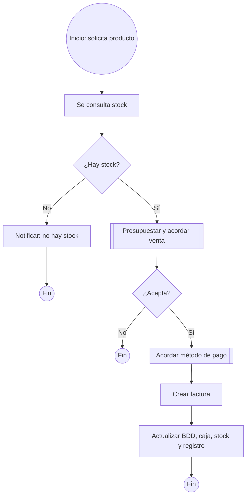

# GMSol — Modelo BPMN v2 (reparación + venta de productos)

> **Uso:** documento único y autosuficiente para cargar como contexto. Consolida el modelo BPMN y las notas abiertas anteriores.
> **Fuente:** diagrama dibujado en pizarra (foto del 29/09/2026). Está rotado y algo borroso; los puntos dudosos están marcados con ⚠️.
> **Negocio:** GM Soluciones Tecnológicas. Lo gestiona una sola persona (el dueño). Hace **servicio técnico** (celulares, PCs, notebooks) y **venta de productos**.

---

## 1. Alcance

**Incluye:** el proceso de reparación y el proceso de venta directa de productos.

**No incluye** (son requisitos aparte, no van en el diagrama): facturación a ARCA/AFIP, estadísticas, caja como módulo, impresión y firma de la orden física, altas de stock/clientes/proveedores.

**Pools:** `Cliente` (simplificado) y `Comercio` (donde ocurre todo).

---

## 2. Convenciones del diagrama

| Símbolo | Significado en este modelo |
|---|---|
| ⭕ Inicio de mensaje | El cliente inicia contacto. Hay **dos** inicios independientes, sin gateway que los una. |
| ▭ con **[+]** | **Subproceso colapsado.** Intercambio "propongo → el cliente responde sí/no". No se dibujan los mensajes de ida y vuelta. |
| ▭ con engranaje ⚙️ | Tarea automática del sistema (crear factura, actualizar BDD, actualizar orden). |
| ◇ **X** | **Gateway exclusivo.** Toda decisión sí/no y toda unión de ramas alternativas. |
| ◇ **+** | **Gateway paralelo (AND).** Se usa **una sola vez** (ver §6.2). |
| ▭ **Call Activity** | Proceso reutilizable llamado como unidad. Se usa para "Solicitar producto ya". |
| ⭕ Fin | Cada rama termina en su propio fin. |

**Pool Cliente:** solo tiene los dos eventos de inicio. Las decisiones del cliente (acepta/no, método de pago) se resuelven como gateways dentro de `Comercio`.

---

## 3. Proceso A — Venta directa ("Solicita producto ya")

No genera orden de trabajo ni ticket para el cliente. Solo factura.

| # | Paso | Tipo |
|---|---|---|
| A1 | Se consulta stock | Tarea |
| A2 | **¿Hay stock?** | Gateway X |
| A2-No | Notificar cliente: no hay stock → **Fin** | Tarea + fin |
| A3 | Presupuestar y acordar venta | Subproceso [+] |
| A4 | **¿Acepta presupuesto?** | Gateway X |
| A4-No | → **Fin** | Fin |
| A5 | Acordar método de pago | Subproceso [+] |
| A6 | Crear factura | Tarea ⚙️ |
| A7 | Actualizar BDD, caja, stock y registro → **Fin** | Tarea ⚙️ + fin |



---

## 4. Proceso B — Reparación ("Solicita reparación")

### 4.1 Ingreso y presupuesto

| # | Paso | Tipo |
|---|---|---|
| B1 | Se consulta stock proveedor | Tarea |
| B2 | **¿Hay stock?** (del repuesto) | Gateway X |
| B2-No | Notificar cliente: no hay stock → **Fin** | Tarea + fin |
| B3 | Presupuestar y acordar reparación | Subproceso [+] |
| B4 | **¿Acepta presupuesto?** | Gateway X |
| B4-No | → **Fin** | Fin |
| B5 | Preparar orden, cargar reparación | Tarea |

### 4.2 Accesorios (opcional, solo los relacionados a la reparación)

| # | Paso | Tipo |
|---|---|---|
| B6 | Consultar si desea agregar accesorios | Subproceso [+] |
| B7 | **¿Desea agregar accesorios?** | Gateway X |
| B7-No | Salta directo a la unión de B13 | — |
| B8 | Consultar accesorio a agregar | Subproceso [+] |
| B9 | Consultar stock | Tarea |
| B10 | **¿Hay stock?** | Gateway X |
| B10-No | Notificar cliente: no hay stock de ese accesorio → **sigue igual**, va a la unión (no cancela la reparación) | Tarea |
| B11 | Presupuestar y acordar accesorio | Subproceso [+] |
| B12 | **¿Desea agregar?** | Gateway X |
| B12-No | Va a la unión | — |
| B12-Sí | Actualizar orden con producto ⚙️ → va a la unión | Tarea |
| B13 | **Unión X** (todas las ramas convergen antes de seguir) | Gateway X |

Accesorios típicos: cable/cargador, funda, templado, teclado (según dispositivo).

### 4.3 Pago inicial y reparación

| # | Paso | Tipo |
|---|---|---|
| B14 | Acordar método y porcentaje de pago (total o seña, y con qué método) | Subproceso [+] |
| B15 | Actualizar orden con pago | Tarea ⚙️ |
| B16 | Arreglar siguiendo orden de reparación, marcar como listo (arreglable / no arreglable) | Tarea |
| B17 | **¿Arreglable?** | Gateway X |
| B17-No | Notificar cliente que no tiene arreglo → **Devolver dinero** → **Fin** | Tareas + fin |
| B18 | **¿Desea avisar al cliente que el arreglo está terminado?** | Gateway X |
| B18-Sí | Notificar cliente arreglo terminado → unión | Tarea |
| B18-No | Va directo a la unión | — |
| B19 | **Unión X** | Gateway X |

### 4.4 Retiro del dispositivo y productos extra

| # | Paso | Tipo |
|---|---|---|
| B20 | Consultar si desea agregar productos | Subproceso [+] |
| B21 | **¿Agrega producto?** | Gateway X |
| B21-No | Va a la unión previa a B25 | — |
| B22 | **¿Desea registrarlo en la orden?** | Gateway X |
| B22-Sí | Actualizar orden ⚙️ → unión previa a B25 | Tarea |
| B22-No | → **Split AND (+)**, ver §6.2 | Gateway + |
| B23 | Rama 1 del AND: **Solicitar producto ya** (Call Activity = Proceso A) → **Fin propio** | Call Activity |
| B24 | Rama 2 del AND: va a la unión previa a B25 | — |

### 4.5 Cierre de la orden

| # | Paso | Tipo |
|---|---|---|
| B25 | **Unión X** (recibe: no agrega / sí registra / rama 2 del AND) | Gateway X |
| B26 | Verificar si adeuda pago | Tarea |
| B27 | **¿Adeuda?** | Gateway X |
| B27-No | Va directo a la unión de B30 | — |
| B27-Sí | Acordar método de pago [+] (solo el saldo) → Registrar pago y actualizar orden → unión | Subproceso + tarea |
| B30 | **Unión X** | Gateway X |
| B31 | Generar factura de la orden | Tarea ⚙️ |
| B32 | Actualizar BDD, caja, stock y registro → **Fin** | Tarea ⚙️ + fin |

### 4.6 Vista general del proceso B

```mermaid
flowchart TD
  S((Inicio: solicita reparación)) --> B1[Se consulta stock proveedor]
  B1 --> G1{¿Hay stock?}
  G1 -- No --> N1[Notificar: no hay stock] --> F1((Fin))
  G1 -- Sí --> B3[[Presupuestar y acordar reparación]]
  B3 --> G2{¿Acepta?}
  G2 -- No --> F2((Fin))
  G2 -- Sí --> B5[Preparar orden, cargar reparación]
  B5 --> B6[[Consultar si desea agregar accesorios]]
  B6 --> G3{¿Desea agregar accesorios?}
  G3 -- No --> J1{Unión}
  G3 -- Sí --> B8[[Consultar accesorio a agregar]] --> B9[Consultar stock] --> G4{¿Hay stock?}
  G4 -- No --> N2[Notificar: no hay stock de accesorio] --> J1
  G4 -- Sí --> B11[[Presupuestar y acordar accesorio]] --> G5{¿Desea agregar?}
  G5 -- No --> J1
  G5 -- Sí --> B12[Actualizar orden con producto] --> J1
  J1 --> B14[[Acordar método y porcentaje de pago]]
  B14 --> B15[Actualizar orden con pago]
  B15 --> B16[Arreglar y marcar como listo]
  B16 --> G6{¿Arreglable?}
  G6 -- No --> N3[Notificar: no tiene arreglo] --> R[Devolver dinero] --> F3((Fin))
  G6 -- Sí --> G7{¿Avisar arreglo terminado?}
  G7 -- Sí --> N4[Notificar arreglo terminado] --> J2{Unión}
  G7 -- No --> J2
  J2 --> B20[[Consultar si desea agregar productos]]
  B20 --> G8{¿Agrega producto?}
  G8 -- No --> J3{Unión}
  G8 -- Sí --> G9{¿Registrarlo en la orden?}
  G9 -- Sí --> B22[Actualizar orden] --> J3
  G9 -- No --> P((AND split +))
  P --> CA[[Call Activity: Solicitar producto ya]] --> F4((Fin propio))
  P --> J3
  J3 --> B26[Verificar si adeuda pago]
  B26 --> G10{¿Adeuda?}
  G10 -- No --> J4{Unión}
  G10 -- Sí --> B28[[Acordar método de pago del saldo]] --> B29[Registrar pago y actualizar orden] --> J4
  J4 --> B31[Generar factura de la orden]
  B31 --> B32[Actualizar BDD, caja, stock y registro]
  B32 --> F5((Fin))
```



---

## 5. Cómo se relacionan los procesos

```
Proceso A (venta directa)  ◄── se dispara desde el inicio "Solicita producto"
        ▲
        └── también se llama como Call Activity desde B23
            (cuando al retirar el equipo el cliente NO quiere el producto en la orden)
```

- El producto pedido al retirar **sin registrar en la orden** lleva **su propia factura** (Proceso A completo).
- La orden de reparación **se cierra por la otra rama** sin esperar esa factura.

---

## 6. Decisiones de diseño (cerradas)

### 6.1 Generales
1. **Orden y factura son documentos distintos.** La orden se entrega al cerrar el ingreso; la factura es el registro de la transacción finalizada.
2. **Dos inicios de mensaje separados**, sin gateway. El cliente puede disparar cualquiera, en cualquier orden y cantidad de veces.
3. **Subprocesos colapsados** para todo intercambio "propongo → cliente responde".
4. **Gateways exclusivos (X)** para todo sí/no y toda unión de ramas alternativas.
5. **Pago en dos momentos:** seña/total al dejar el equipo (B14) y saldo al retirar (B27-Sí). Son subprocesos separados porque ocurren en momentos y condiciones distintas.
6. **Actualizar BDD** engloba precio, stock, **caja** y registro. Ocurre después de facturar.

### 6.2 Split paralelo (AND) en el cierre
- Cuando el cliente agrega un producto al retirar y **no** lo quiere en la orden, se abre un **AND (+)**:
  - **Rama 1:** Call Activity "Solicitar producto ya" → fin propio.
  - **Rama 2:** la orden sigue su cierre normal.
- **No hay unión AND.** Cada rama termina sola.
- La Call Activity es síncrona, pero como está en su propia rama, **no bloquea** el cierre.
- La unión previa a B25 es **X** porque, por instancia, llega un solo camino.

### 6.3 Reglas de negocio
| Regla | Detalle |
|---|---|
| Falta de stock de **accesorio** | Solo notifica y sigue. **Nunca** cancela la reparación. |
| Falta de stock de **repuesto** | Sí termina el proceso (B2-No). |
| **No arreglable** | Notifica, devuelve dinero, fin. No pasa por accesorios/productos ni por facturación de reparación. |
| **Accesorios** | Solo los relacionados a la reparación. Un producto suelto siempre es una venta aparte (Proceso A). |
| Aviso de arreglo terminado | Opcional (decide el empleado). |

---

## 7. Cambios respecto a la versión anterior

| Cambio | Estado |
|---|---|
| "No acepta presupuesto" de reparación → fin | ✅ agregado |
| "Devolver dinero" tras "no arreglable" | ✅ agregado |
| Gateway "¿Agrega producto?" antes de "¿Registrarlo en la orden?" | ✅ visible |
| Actualizar BDD ahora incluye **caja** | ✅ |
| Rama "No" del cierre: Call Activity + cierre de orden en paralelo | 🔄 definido con AND (ver ⚠️ abajo) |
| Call Activity con evento de fin propio | ✅ confirmado |

---

## 8. Pendientes y dudas

| # | Tema | Nota |
|---|---|---|
| 1 | ⚠️ **Verificar el símbolo del split** previo a "Solicitar producto ya" | En la foto no se distingue si es **+** o **X**. Debe ser **+** con dos salidas. |
| 2 | ⚠️ Gateways de la zona de accesorios | Deben ser **X**. |
| 3 | **Inicio de la Call Activity** | Un proceso llamado debe empezar con inicio "none", no de mensaje. Se resuelve después. |
| 4 | **Alcance vs. pendientes** | El alcance excluye ARCA y la orden física, pero se quieren "¿Desea facturar?" y el plazo de 30 días dentro del diagrama. Decidir. |
| 5 | **Devolver dinero** | Solo aplica si hubo seña. Opcional: gateway "¿Pagó algo?". |
| 6 | **Accesorios múltiples** | El flujo agrega uno solo. Falta un bucle para "cable **y** templado". |
| 7 | **Pedido de repuestos al proveedor** | Solo existe la consulta de stock, falta el proceso. |
| 8 | **Recargo por tarjeta / seña en dos métodos** | No se ve en el subproceso de pago. |
| 9 | **Call Activity para "Acordar método de pago"** | Se repite en 3 puntos (A5, B14, B27). Convendría una definición única. |
| 10 | **Fusionar "Acordar método de pago" + "Crear factura"** | Se recomendó mantenerlos separados (negociación vs. efecto interno). Falta confirmar. |
| 11 | **Flecha duplicada** | Entre "Acordar método de pago" y "Crear factura" (una roja y una negra). Borrar una. |
| 12 | **Nombres** | Unificar "Crear factura" vs. "Generar factura de la orden". |
| 13 | **Casos** (`Casos`) | Hay un typo ("UN A ARREGLAR") y combinaciones faltantes. Un producto retirado al dejar el equipo con pago "al final" implicaría deuda/fiado, no modelado. |
| 14 | **Seña = 0%** | B14 no lo contempla explícitamente. |
