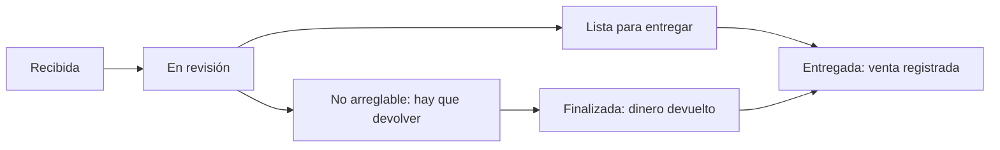
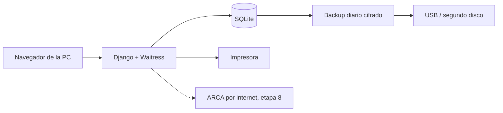

# GMSol — Stack y arquitectura (v4)

> **Uso:** documento autosuficiente para cargar como contexto. Complementa a [BPMN.md](../BPMN%20Y%20MODELO/BPMN.md), [0_Plan.md](../MODULOS/0_Plan.md) (etapas y entrega al cliente) y [etapa-7-interfaz.md](etapa-7-interfaz.md) (pantallas).
> **Estado (21/11/2026):** en construcción. Etapas 1 a 3 y casi toda la 7 hechas. Proyecto **real, para producción**, sin fecha límite.
> **Leyenda:** ✅ definido · 🟡 propuesto (falta confirmar) · ⏭️ más adelante

---

## 1. Resumen de decisiones

| Tema | Decisión | Estado |
|---|---|---|
| Lenguaje y framework | **Python + Django** | ✅ |
| Base de datos | **SQLite**, también en producción (ver §6) | ✅ |
| Tipo de app | Web, usada desde el navegador de la PC del local | ✅ |
| Arquitectura | Monolito en capas; las reglas del negocio en `catalogo/servicios.py` | ✅ |
| Estado de la orden | Se **calcula** a partir del estado de cada equipo (ver §5) | ✅ |
| Pantallas | Plantillas de Django + HTMX + **CSS propio** (sin Bootstrap ni Tailwind) | ✅ |
| Servidor | **Local, en la PC del negocio con Windows**, con Waitress. Vercel descartado (ver §9) | ✅ |
| Backups | **Copia local cifrada** (USB o segundo disco). Subirla a Google Drive: ⏭️ más adelante, si se quiere | ✅ |
| Costo | **$0**: todo el stack es gratuito | ✅ |
| Usuarios | Uno solo (por ahora), con login | ✅ |

---

## 2. Contexto del negocio (respuestas confirmadas)

| Dato | Valor |
|---|---|
| Equipo del dueño | Usa principalmente una **PC con Windows** y tiene **impresora** |
| Internet en el local | Estable |
| Empleados | Ninguno por ahora |
| Régimen fiscal | **Monotributista** (por lo general se emite **Factura C**) |
| Datos existentes | Varias planillas Excel (precios, stock, compras, registros). Migrarlas es **deseable, no obligatorio** |
| Firma del cliente | **En papel** |
| Recargos por método de pago | Precargados y fijos; **al registrar la venta siempre se puede cambiarlos** |
| Estética de la interfaz | Para el dueño no es prioridad; para el desarrollador sí: minimalista y nada genérico (ver la [guía de diseño](../BPMN%20Y%20MODELO/guia-de-diseno-gmsol.md)) |
| Presupuesto | **$0**: todo debe ser gratuito, sin pagar hosting |
| Respaldo de datos | Local por ahora. Google Drive gratuito (15 GB) ⏭️ más adelante |

---

## 3. Lenguaje y framework

### 3.1 Elección: Python + Django

Por qué:
- El sistema tiene muchas **altas** (productos, clientes, proveedores, dispositivos). El **admin de Django** sirvió al principio y hoy queda para correcciones puntuales.
- Menos piezas nuevas que aprender que con TypeScript.
- Leer y migrar los Excel es sencillo.
- La orden se **imprime desde el navegador** (una hoja para el taller y media hoja para el cliente): no hace falta una librería de PDF.
- Hay bastante material en español sobre facturación con ARCA/AFIP en Python.

Alternativa descartada: TypeScript (Node + NestJS + React). Hay que armar casi todo a mano y llevar dos proyectos.

### 3.2 Plan B: Java (Spring Boot) — descartado por ahora

El desarrollador **domina Java** y se acordó que, si Django no convencía, se migraba. **Se siguió con Django**: el sistema ya está construido y con tests. Las reglas que se fijaron para que una migración fuera barata siguen valiendo como buena práctica:

| Regla | Para qué |
|---|---|
| Reglas del negocio en **funciones propias** (`servicios.py`), no en las vistas | Las pantallas no deciden nada; las reglas están en un solo lugar |
| **Esquema claro**, definido en los modelos y las migraciones de Django | La base se entiende sin leer el código |
| Lógica de estados y flujos **documentada en `.md`** | Sirve de especificación en cualquier lenguaje |

---

## 4. Arquitectura

Monolito en 3 capas:

```
Pantallas (app web)  →  Reglas del negocio (catalogo/servicios.py)  →  Base de datos (modelos)
```

Las reglas (estados, recargos, registrar ventas, mover caja y stock) viven en la capa del medio. Patrones previstos para la etapa 6 (después de la versión final):

| Patrón | Dónde se usaría |
|---|---|
| **State** | Transiciones de estado de los equipos de la orden |
| **Strategy** | Métodos de pago y cálculo de recargos |

---

## 5. Control de flujo y estado

- **No se usa un motor BPMN.** El BPMN es guía de diseño.
- El sistema **no modela la charla con el cliente** (presupuestar, negociar, aceptar). Solo **registra resultados**.
- La **venta directa no tiene estados**: es una única transacción.
- **"Solicitar producto ya"** al retirar = crear una venta directa aparte.
- **Cada equipo** de la orden tiene su estado guardado: `pendiente` (en revisión / reparación), `sin_falla`, `arreglado` o `no_arreglable`.
- **El estado de la orden se calcula** a partir de sus equipos, sus pagos y su venta; no se guarda. En pantalla se dibuja como una pista:



> El detalle está en el [diagrama de clases v6](../MODULOS/diagrama-clases-modulos-1-a-3-v6.md) (§4).

---

## 6. Base de datos y persistencia

**SQLite.** Las operaciones que tocan varias tablas van dentro de `transaction.atomic` (o todo o nada).

**Por qué SQLite en producción:** un solo usuario en una sola PC; no hay que instalar ni mantener un servidor de base de datos en Windows; la base es un archivo, así que el backup y la restauración son simples. Si algún día hubiera varios usuarios a la vez o acceso desde otras PC, se evalúa pasar a otra base (Django lo permite cambiando la configuración).

| Qué | Cómo se guarda |
|---|---|
| Estado de cada equipo | Columna `estado` en `EquipoRecibido` |
| Estado de la orden | **Se calcula** (no hay columna) |
| Historial de estados | ⏭️ Etapa 6: tabla que solo se agrega, nunca se edita |
| Dinero | ⬜ Etapa 4: movimientos de caja por cuenta (efectivo / digital). El saldo se calcula |
| Stock | ⬜ Etapa 4: movimientos de stock, misma lógica |
| Ventas | No se modifican. Un error se corrige con otro registro (o se anula una venta rápida cargada por error) |

**Reglas:**
- Al registrar la venta, **venta + stock + caja se guardan en una sola transacción**.
- El dinero se guarda como `DecimalField`, **nunca** `float`.
- **Migración de Excel:** script de importación para precios, stock y compras (etapa 11).

---

## 7. Seguridad (mínima, pero necesaria)

Aunque corra en la PC del local, la orden guarda **PIN y patrones de bloqueo** de los dispositivos de clientes.

| Medida | Estado |
|---|---|
| Login con contraseña guardada con hash | ✅ |
| Todas las pantallas piden login | ✅ |
| HTTPS | Solo si algún día se accede desde fuera de la PC. En `localhost` no hace falta |
| **Backups automáticos** (lo más importante), **cifrados** | ✅ (se arman en la etapa 12) |
| Clave secreta y credenciales de ARCA fuera del código (variables de entorno) | ✅ |

---

## 8. Interfaz de usuario

- **Plantillas de Django + HTMX** (actualiza partes de la pantalla sin JavaScript complejo).
- **CSS propio** en un solo `gmsol.css`, con las variables de la [guía de diseño](../BPMN%20Y%20MODELO/guia-de-diseno-gmsol.md). Tipografías en archivos locales.
- La pista de progreso muestra el estado de la orden y solo aparecen los **botones válidos** para ese estado.
- **Impresión desde el navegador:** la orden en una hoja (para el taller) y el comprobante en media hoja (para el cliente, con el aviso de 30 días). La firma del cliente es en papel.

Las pantallas y decisiones están en [etapa-7-interfaz.md](etapa-7-interfaz.md).

---

## 9. Servidor (todo gratis)

**Restricción:** presupuesto $0. Todo tiene que ser gratuito y permitido para uso comercial (es un negocio real).

### 9.1 ¿Vercel lo resuelve? No

| Motivo | Detalle |
|---|---|
| **Uso comercial** | El plan gratis (Hobby) es **solo para uso personal no comercial**. Un negocio real requiere el plan Pro, que ronda los **US$20 por mes** |
| Encaje técnico | Está pensado sobre todo para sitios y funciones en la nube (Next.js/Node). Django con una base en un archivo no es su caso |

### 9.2 Opciones gratis

| Opción | Costo | Pro | Contra |
|---|---|---|---|
| **PC del negocio (local)** ✅ elegida | $0 | Sin límites ni cuentas de terceros. Los datos quedan en el local. No expuesta a internet | Solo se usa desde el local. Si falla la PC, depende del backup |
| Oracle Cloud "Always Free" (nube) | $0 | Acceso desde cualquier lugar | Pide tarjeta, puede recuperar instancias inactivas y no garantiza el servicio |
| Vercel Hobby | $0 | — | **No permite uso comercial** |

### 9.3 Stack 100% gratuito

| Pieza | Herramienta | Costo |
|---|---|---|
| Framework | Django (código abierto) | $0 |
| Base de datos | SQLite (viene con Python) | $0 |
| Pantallas | HTMX + CSS propio | $0 |
| Impresión | El navegador | $0 |
| Servidor de la app | **Waitress** (servidor de producción para Windows) + **WhiteNoise** (archivos estáticos) | $0 |
| Arranque automático y backups | Programador de tareas de Windows | $0 |
| Cifrado del backup | 7-Zip (AES-256) | $0 |

### 9.4 Cómo funciona



- Django corre **en la misma PC** del negocio y se usa desde el navegador (`localhost`).
- Internet solo hará falta para facturar con ARCA (etapa 8).
- **El backup es obligatorio:** si la PC falla, es lo único que protege los datos (ver §9.5).

### 9.5 Backups

| Qué se guarda | Cuánto tiempo |
|---|---|
| Backups diarios | Últimos 30 días |
| Backups mensuales | Últimos 12 meses |
| Lo demás | Se borra automáticamente |

**Cómo funciona:**
1. Una tarea programada de Windows corre cada día un comando propio de Django que copia la base con la **API de backup de SQLite** (copiar el archivo a mano mientras el sistema está abierto puede dejar una copia dañada).
2. La copia se comprime y se **cifra con contraseña** con 7-Zip (la base tiene PIN y patrones de bloqueo de clientes).
3. Se guarda en un USB o en un segundo disco.
4. Se borran los backups viejos según la retención.

| Punto | Detalle |
|---|---|
| Probar la restauración | Un backup que nunca se probó no es confiable. Probarlo al menos una vez antes de la beta |
| La contraseña del cifrado | Anotada en papel, fuera de la PC: sin ella el backup no sirve |
| Google Drive | ⏭️ Más adelante, si se quiere una copia fuera del local (cuenta dedicada al negocio, subiendo solo el archivo cifrado; nunca sincronizar la base en uso) |

### 9.6 Más adelante (opcional)

Si se necesita acceso desde fuera del local o desde el celular, se evalúan opciones gratuitas. Se decide cuando haga falta.

---

## 10. Pendientes

| # | Tema |
|---|---|
| 1 | ~~Confirmar el sistema operativo~~ ✅ Windows |
| 1b | Confirmar que la integración con ARCA no tenga costo (certificado digital y servicios) |
| 2 | Cómo integrar la facturación con ARCA (directo o mediante un servicio intermedio) |
| 3 | ~~Diagrama de clases~~ ✅ (v6) |
| 4 | ~~Modelo de datos~~ ✅ (en los modelos de Django; SQLite) |
| 5 | ~~Decidir si se migra a Java~~ ✅ se sigue con Django |
| 6 | Pendientes del BPMN v2 (accesorios múltiples, pedido de repuestos, seña 0%, etc.) |
| 7 | ⏭️ Copia del backup en Google Drive (más adelante) |
