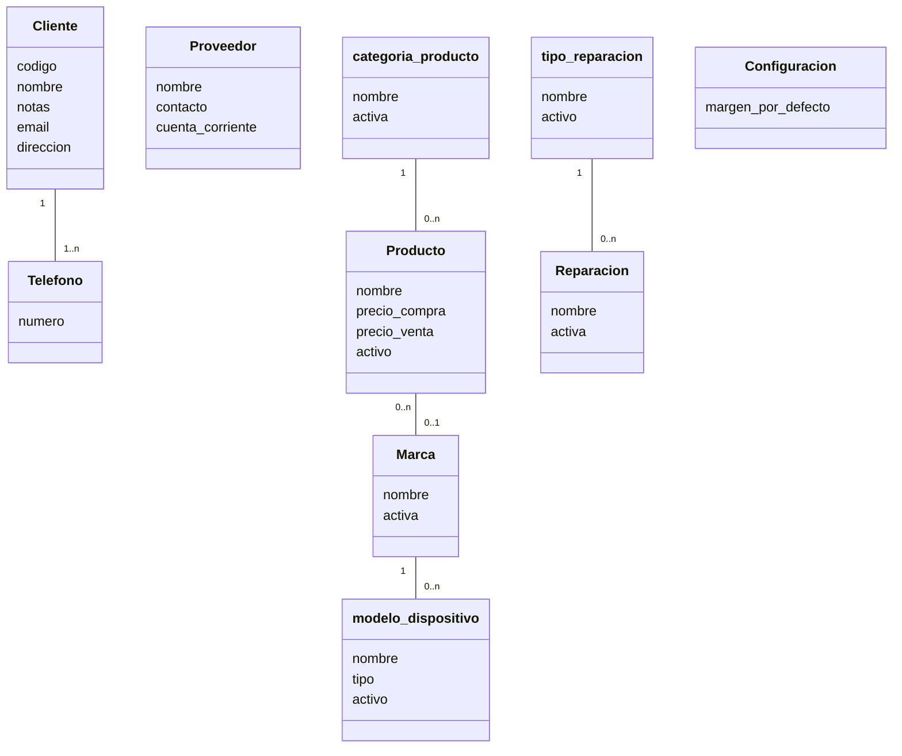

# GMSol — Diagrama de clases, Módulo 1: Catálogo (v1)

> **Uso:** documento autosuficiente para cargar como contexto. Complementa a `GMSol-decisiones-diagrama-clases.md`, `GMSol-modelo-BPMN-taller-v2.md` y `GMSol-stack-y-arquitectura.md`.
> **Estado:** módulo 1 cerrado por el desarrollador. Falta el detalle del teléfono (ver §6).
> **Leyenda:** ✅ decisión del desarrollador · 💡 propuesta (falta confirmar) · ❓ pendiente

---

## 1. Diagrama



**Cómo se lee una cardinalidad:** el número junto a una clase dice cuántos objetos de *esa* clase se relacionan con **uno** del otro lado.
Ejemplo: `categoria_producto "1" -- "0..n" Producto` = una categoría tiene de 0 a n productos; un producto tiene exactamente 1 categoría.

`Proveedor` y `Configuracion` no tienen relaciones en este módulo.

---

## 2. Clases y atributos

| Clase | Atributos | Notas |
|---|---|---|
| **Cliente** | código, nombre, notas, email, dirección | ✅ Obligatorios: nombre y al menos un teléfono. **Opcionales:** email y dirección. Sin DNI (eliminado por ahora) |
| **Telefono** | número | ✅ Clase separada: un cliente puede tener más de uno. ❓ Falta definir etiqueta y principal (§6) |
| **Proveedor** | nombre, contacto, cuenta corriente sí/no | ❓ "otros datos" sin definir |
| **categoria_producto** | nombre, activa | ✅ Editable por el dueño (agregar, quitar, modificar) |
| **Producto** | nombre, precio de compra, precio de venta, activo | ✅ Los accesorios son productos. Los productos "con variantes" van como productos distintos (como el Excel) |
| **Marca** | nombre, activa | ✅ Lista compartida entre productos y dispositivos |
| **modelo_dispositivo** | nombre, tipo (celular o notebook), activo | ✅ Es el modelo del **equipo que se repara**, no de un producto. La PC no lleva modelo |
| **tipo_reparacion** | nombre, activo | ✅ Editable por el dueño. Agrupa reparaciones para estadísticas |
| **Reparacion** | nombre, activa | ✅ Catálogo de reparaciones. **Sin precio**: el precio se pone en cada orden |
| **Configuracion** | margen por defecto (%) | ✅ Un solo margen para todos los productos, que el dueño cambia cuando quiera |

---

## 3. Relaciones

| Relación | Cardinalidad | Regla |
|---|---|---|
| Cliente — Teléfono | 1 — 1..n | Un cliente tiene al menos un teléfono |
| categoria_producto — Producto | 1 — 0..n | ✅ Un producto tiene **una sola** categoría |
| Producto — Marca | 0..n — 0..1 | ✅ La marca del producto es **opcional** (hay productos de marcas "truchas") |
| Marca — modelo_dispositivo | 1 — 0..n | Un modelo es de una sola marca |
| tipo_reparacion — Reparacion | 1 — 0..n | Una reparación es de un solo tipo |

✅ Todas las relaciones se dibujan **en ambos sentidos** (cada lado conoce al otro).

---

## 4. Reglas de diseño

| Regla | Detalle |
|---|---|
| **Nada se borra, se desactiva** | `activa` / `activo` en las clases editables, para no romper órdenes ni estadísticas históricas |
| **Al desactivar una categoría con productos** | ✅ Los productos existentes siguen mostrándola, y se pueden reasignar después. 💡 Una categoría inactiva no aparece al cargar productos nuevos. Lo mismo para tipos de reparación y marcas |
| **El margen no se guarda** | Se calcula con precio de compra y de venta. El `margen por defecto` solo **sugiere** el precio de venta al cargar el producto; el dueño puede poner el que quiera |
| **Categorías y tipos son datos, no herencia** | Hay una sola clase `categoria_producto`; "Cable" o "Cargador" son objetos que el dueño crea en ejecución |
| **Lo fijo es enumeración** | "celular o notebook" no cambia, así que no es una clase editable |
| **Margen por categoría** | ❓ Quizá más adelante. Se agregaría un margen opcional a `categoria_producto`; hoy no se hace |

---

## 5. Adelanto del módulo 2 (💡 a confirmar al trabajarlo)

La orden no apunta directo al catálogo: tiene **líneas** que guardan su propio precio (así las órdenes viejas no cambian si sube un precio).

```
Orden ── Cliente
  ├─ Dispositivo de la orden (1..n) ── modelo_dispositivo (la PC va sin modelo)
  │     └─ Reparación realizada (0..n) ── reparacion + precio de esa orden
  └─ Línea de producto (0..n) ── producto + cantidad + precio de ese momento
```

| Grupo | Responde |
|---|---|
| Catálogo (módulo 1) | "¿Qué existe en el negocio?" |
| Orden y ventas (módulos 2 y 3) | "¿Qué pasó?" |

---

## 6. Pendientes

| # | Tema |
|---|---|
| 1 | ❓ **Teléfono:** si un cliente tiene varios, ¿cuál se muestra junto al nombre? 💡 Marcar uno como principal. ¿Etiqueta (casa, trabajo, WhatsApp)? |
| 2 | ❓ **Convención de nombres:** hoy mezcla `categoria_producto` (snake_case) con `Cliente` (mayúscula). Decidir una sola. Lo usual es PascalCase para clases y snake_case para tablas y atributos |
| 3 | ❓ Datos extra de `Proveedor` |
| 4 | ❓ ¿Registrar el **costo del repuesto** en cada reparación de la orden (para saber la ganancia, aunque no descuente stock)? Se ve en el módulo 2 |
| 5 | ❓ Margen por categoría (futuro) |

---

> **Me gusta que me preguntes si quiero avanzar al siguiente paso o no, antes de avanzar.**
