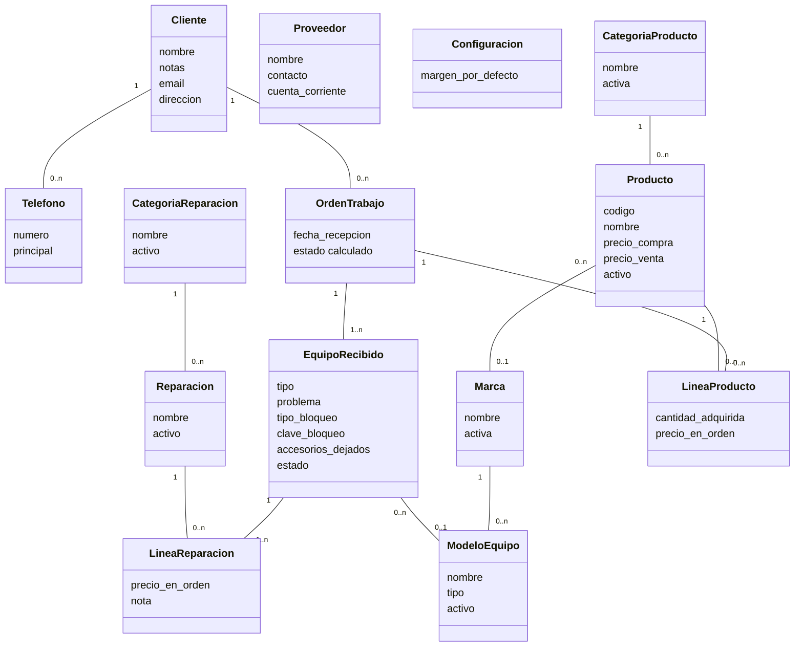

# GMSol — Diagrama de clases (v4, módulos 1 y 2)

> **Uso:** documento autosuficiente para cargar como contexto. **Reemplaza** a `GMSol-diagrama-clases-v3.md`. Complementa a `casos_puntuales_dise�o.md`, `BPMN.md`, `stack_tecnologico.md`
> **Estado:** módulos 1 (catálogo) y 2 (orden de trabajo) cerrados, salvo lo marcado ❓. Faltan los módulos 3 a 5 (pagos y facturación, caja, compras).
> **Código:** las clases del diagrama ya existen como modelos de Django en la demo (`gmsol_demo/catalogo/models.py`), salvo `Producto.codigo`, `Proveedor`, `Configuracion`
> **Leyenda:** ✅ decisión del desarrollador · 💡 propuesta (falta confirmar) · ❓ pendiente

---

## 1. Diagrama

**Cómo se lee una cardinalidad:** el número junto a una clase dice cuántos objetos de *esa* clase se relacionan con **uno** del otro lado. Ejemplo: `CategoriaProducto "1" -- "0..n" Producto` = una categoría tiene de 0 a n productos; un producto tiene exactamente 1 categoría.

`Proveedor` y `Configuracion` no tienen relaciones por ahora. El número de la orden es su `id` (automático) y `fecha_recepcion` se completa sola (no admite fechas pasadas).

---

## 2. Clases (solo lo que no se ve en el diagrama)

| Clase | Módulo | Nota |
|---|---|---|
| Cliente | 1 | ✅ Obligatorios: nombre y teléfono (regla suave, ver §4). Opcionales: email y dirección. Sin DNI. ❓ `codigo` (estaba en v2): el `id` ya distingue a dos clientes con el mismo nombre; decidir si se mantiene |
| Telefono | 1 | ✅ Clase separada, con `principal` (sí/no). ❓ Falta etiqueta y regla de un solo principal |
| Proveedor | 1 | ❓ "Otros datos" sin definir |
| Configuracion | 1 | ✅ Un solo margen por defecto para todos los productos |
| CategoriaProducto | 1 | ✅ Editable por el dueño. Incluye una categoría genérica |
| Producto | 1 | ✅ Los accesorios son productos. Las variantes van como productos distintos. `codigo` visible y editable; el `id` es interno |
| Marca | 1 | ✅ Compartida entre productos y modelos de equipo |
| ModeloEquipo | 1 | ✅ Modelo del equipo que se repara (celular o notebook), no de un producto |
| CategoriaReparacion | 1 | ✅ Editable por el dueño. Agrupa las variantes de una reparación (módulo OLED, económico, original…) para estadísticas. Incluye una categoría genérica |
| Reparacion | 1 | ✅ Catálogo de reparaciones. **Sin precio**. Incluye "Revisión / diagnóstico" (precio $0 o tarifa) |
| OrdenTrabajo | 2 | ✅ Un trabajo por visita del cliente. Siempre tiene al menos un equipo. No guarda estado: lo calcula (§4) |
| EquipoRecibido | 2 | ✅ Un equipo dejado en la orden. Guarda el `estado` (`pendiente`, `arreglado`, `no_arreglable`, `sin_falla`). La PC va sin modelo |
| LineaReparacion | 2 | ✅ Reparación del catálogo acordada para un equipo, con **precio de esa orden** |
| LineaProducto | 2 | ✅ Producto agregado a la orden, con **precio propio** (se copia del producto al agregarlo y se puede cambiar) |

---

## 3. Relaciones

| Relación | Cardinalidad | `on_delete` en el código | Regla |
|---|---|---|---|
| Cliente — Telefono | 1 — 0..n | `CASCADE` | ✅ Regla suave: se pide al menos uno, pero se puede guardar sin teléfono confirmándolo (§4) |
| CategoriaProducto — Producto | 1 — 0..n | `PROTECT` | ✅ Un producto tiene una sola categoría |
| Producto — Marca | 0..n — 0..1 | `PROTECT` | ✅ Marca opcional (hay marcas "truchas") |
| Marca — ModeloEquipo | 1 — 0..n | `PROTECT` | Un modelo es de una sola marca |
| CategoriaReparacion — Reparacion | 1 — 0..n | `PROTECT` | Una reparación es de una sola categoría |
| Cliente — OrdenTrabajo | 1 — 0..n | `PROTECT` | Toda orden tiene cliente |
| OrdenTrabajo — EquipoRecibido | 1 — 1..n | `CASCADE` | ✅ Varios equipos por orden. Toda orden tiene al menos uno: una venta solo de productos es venta directa, sin orden (BPMN, proceso A) |
| EquipoRecibido — LineaReparacion | 1 — 1..n | `CASCADE` | Todo equipo lleva al menos una línea (si llega sano o sin diagnóstico, "Revisión / diagnóstico") |
| EquipoRecibido — ModeloEquipo | 0..n — 0..1 | `PROTECT` | Opcional: la PC no lleva modelo |
| Reparacion — LineaReparacion | 1 — 0..n | `PROTECT` | Cada línea apunta al catálogo |
| OrdenTrabajo — LineaProducto | 1 — 0..n | `CASCADE` | La línea es parte de la orden |
| Producto — LineaProducto | 1 — 0..n | `PROTECT` | Cada línea apunta al catálogo |

✅ Todas las relaciones se dibujan en ambos sentidos. No se dibujan relaciones que se pueden derivar: no existe OrdenTrabajo — LineaReparacion, se llega pasando por `EquipoRecibido`. Criterio de `on_delete`: `CASCADE` cuando la clase es **parte de** otra; `PROTECT` cuando apunta a un dato del catálogo que no debe desaparecer si está en uso.

---

## 4. Reglas de diseño

| Regla | Detalle |
|---|---|
| **Nada se borra, se desactiva** | `activa` / `activo` en las clases editables, para no romper órdenes ni estadísticas. Al desactivar una categoría con productos, ✅ los productos siguen mostrándola y se pueden reasignar. 💡 Una categoría inactiva no aparece al cargar productos nuevos |
| **El margen no se guarda** | Se calcula con precio de compra y de venta. `Configuracion.margen_por_defecto` solo sugiere el precio de venta; el dueño puede poner el que quiera |
| **Datos editables vs. enumeraciones** | Categorías son datos (una clase, objetos creados en ejecución). Lo fijo es enumeración: tipo de equipo (celular, notebook, pc), tipo de modelo (celular, notebook), estado del equipo, tipo de bloqueo. Se guarda un valor interno simple (sin tildes ni mayúsculas, por ejemplo `contrasena`, `ninguno`) y se muestra una etiqueta legible |
| **Orden en tres niveles** | ✅ OrdenTrabajo → EquipoRecibido → LineaReparacion. El equipo existe aunque todavía no tenga reparaciones |
| **Estados** | ✅ El estado se guarda **solo en `EquipoRecibido`**: `pendiente`, `arreglado`, `no_arreglable`, `sin_falla`. El estado de la orden **se calcula** a partir de sus equipos (como el margen), así no pueden contradecirse. ✅ Orden en reparación si algún equipo está pendiente; lista si ninguno lo está (el detalle de qué equipo no se arregló queda en cada equipo); retirada y facturada cuando existan retiro y factura |
| **Transiciones y historial** | 💡 Las transiciones permitidas viven en un solo lugar (clase común de Python, no en el admin); con 3 estados alcanza un mapa de transiciones y el patrón State completo queda opcional. Historial en una tabla que solo se agrega (equipo, estado anterior, estado nuevo, fecha). Las pantallas ofrecen solo acciones válidas |
| **Equipo no arreglable** | La devolución de dinero sale de sumar las `LineaReparacion` de ese equipo (módulo 3) |
| **Precio por orden** | ✅ El precio de una reparación se pone en cada orden (depende del costo del repuesto). Las líneas guardan **su propio precio**, así las órdenes y facturas viejas no cambian |
| **Problema, accesorios y clave** | ✅ El problema es texto libre en `EquipoRecibido`. Los accesorios que deja el cliente son una nota; no son productos ni tienen stock. ✅ La clave de bloqueo se guarda tal cual (dato sensible: protegido por el login y por backups cifrados). 💡 Un solo campo de texto; el patrón se guarda como secuencia de puntos 1 a 9 de la grilla (por ejemplo `1-5-9-6`) |
| **`id` y `codigo`** | `id` es interno e inmutable (las demás tablas apuntan a él). `codigo` es el que ve el dueño: autogenerado y corto al principio, editable cuando use lector de códigos de barras. Se busca por `codigo` |
| **Tipo del equipo** | 💡 Si el equipo tiene modelo, su tipo debe coincidir con el del modelo. Para una PC solo existe el tipo del equipo |
| **Nombres** | ✅ Español. PascalCase para las clases en el UML y en el código; snake_case para los atributos |
| **Facturación** | Se modela en el módulo 3. La orden entrega sus renglones con precio propio |
| **Pantalla de la orden** | El admin de Django no anida dos niveles. La pantalla será propia (plantillas de Django + HTMX). El caso habitual (1 equipo, 1 reparación) va en una sola pantalla |
| **Categorías genéricas** | ✅ Toda reparación y todo producto tiene categoría obligatoria. Existe una categoría genérica ("Otras") para lo que no encaja, así las estadísticas no tienen casos sin categoría |
| **Equipo sano o sin diagnóstico** | ✅ Todo equipo lleva al menos una línea. Si llega sano o sin diagnóstico se usa "Revisión / diagnóstico" y, si no tiene falla, queda `sin_falla` (cuenta como resuelto, no como arreglado) |
| **Teléfono: regla suave** | ✅ Se pide siempre, pero se puede guardar un cliente sin teléfono confirmándolo, y el sistema lista los clientes sin teléfono para completarlos. En el admin se mantiene el bloqueo durante el desarrollo; la confirmación va en las pantallas propias |
| **LineaProducto** | ✅ Precio copiado del producto al agregarlo y editable (descuento). Se puede quitar antes de facturar. **El stock se descuenta al facturar** (factura + stock + caja en una transacción), no al agregar la línea. Cantidad mínima 1 y precios no negativos. Ambas líneas comparten `precio_en_orden` y `subtotal`, así la factura las trata igual |
| **Orden sin equipos** | ✅ No existe. El modelo no lo puede exigir; se valida en la pantalla (como el teléfono) |
| **Fecha de recepción** | ✅ Se completa sola al crear la orden y no se puede editar ni poner fechas pasadas |

---

## 5. Pendientes

| # | Tema |
|---|---|
| 1 | ❓ Transiciones: ¿se puede volver de `arreglado` a `pendiente` (reclamo)? ¿Se bloquea el estado después de facturar? Nuevo estado "esperando repuesto" (aparece en los casos) |
| 2 | ❓ Stock insuficiente al facturar: se verifica al agregar la línea, pero puede cambiar hasta la factura |
| 3 | ❓ ¿Registrar el **costo del repuesto** en cada línea de reparación (para saber la ganancia)? |
| 4 | ❓ Teléfono: etiqueta y regla de un solo principal |
| 5 | ❓ `Producto.codigo`: implementarlo; choque entre un código autogenerado y uno editado a mano |
| 6 | ❓ `Cliente.codigo`: ¿se mantiene? |
| 7 | ❓ Datos extra de `Proveedor` |
| 8 | ❓ Margen por categoría (futuro) |
| 9 | ❓ Historial de estados (tabla que solo se agrega): pendiente en el código |
| 10 | ❓ Blindar en la base de datos las reglas de cantidad y precio (restricción de la tabla): hoy solo las validan los formularios |
| 11 | ❓ Módulos 3 a 5: pagos, facturación (relación Factura — Pago), caja y compras |

---

> **Me gusta que me preguntes si quiero avanzar al siguiente paso o no, antes de avanzar.**
