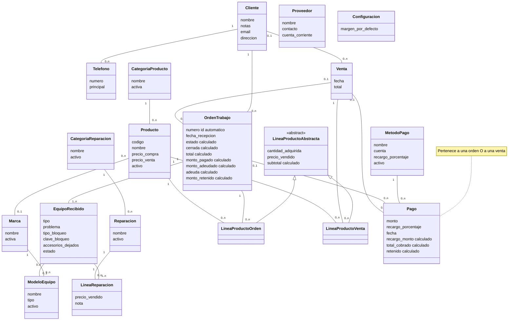

# GMSol — Diagrama de clases (v5, módulos 1 a 3 hasta la Venta)

> **Uso:** documento autosuficiente para cargar como contexto. **Reemplaza** a [diagrama-clases-modulo1y2-orden.md](diagrama-clases-modulo1y2-orden.md) (v4). Complementa a [BPMN.md](../BPMN%20Y%20MODELO/BPMN.md), [stack_tecnologico.md](../DISEÑO/stack_tecnologico.md) y [0_Plan.md](0_Plan.md). **Reemplazado** por la [v6](diagrama-clases-modulos-1-a-3-v6.md).
> **Estado:** módulos 1 (catálogo) y 2 (orden de trabajo) cerrados. Módulo 3 (pagos y ventas): `MetodoPago`, `Pago`, `Venta`, líneas de venta directa y dinero retenido hechos y con tests (Fase 2, pasos 1 a 4). Falta el cierre de orden (paso 5) y la venta directa (paso 5b). Pruebas manuales en el admin en curso. Faltan los módulos 4 y 5 (caja y movimientos, compras).
> **Código:** las clases del diagrama están en `negocio/models/` (hasta el 21/11/2026 era `catalogo/models.py`), salvo `Producto.codigo`, `Proveedor`, `Configuracion`.
> **Vocabulario:** **Venta** = registro interno que cierra una transacción e impacta stock y caja (antes "factura"). **Comprobante ARCA** = documento legal, es otra cosa (etapa 8).
> **Leyenda:** ✅ decisión del desarrollador · 💡 propuesta (falta confirmar) · ❓ pendiente

---

## 1. Diagrama

**Cómo se lee una cardinalidad:** el número junto a una clase dice cuántos objetos de *esa* clase se relacionan con **uno** del otro lado. Ejemplo: `Venta "0..1" -- "0..n" Pago` = una venta tiene de 0 a n pagos; un pago tiene 0 o 1 venta.

`Proveedor` y `Configuracion` no tienen relaciones por ahora. El número de la orden es su `id` y `fecha_recepcion` se completa sola (no admite fechas pasadas).

---

## 2. Clases (solo lo que no se ve en el diagrama)

| Clase | Módulo | Nota |
|---|---|---|
| Cliente | 1 | ✅ Obligatorios: nombre y teléfono (regla suave, ver §4). Opcionales: email y dirección. Sin DNI. ❓ `codigo`: decidir si se mantiene |
| Telefono | 1 | ✅ Clase separada, con `principal`. ❓ Falta etiqueta y regla de un solo principal |
| Proveedor | 1 | ❓ "Otros datos" sin definir. Se usa en el módulo 5 |
| Configuracion | 1 | ✅ Un solo margen por defecto para todos los productos |
| CategoriaProducto | 1 | ✅ Editable por el dueño. Incluye una categoría genérica |
| Producto | 1 | ✅ Los accesorios son productos. Las variantes van como productos distintos. `codigo` visible y editable; el `id` es interno |
| Marca | 1 | ✅ Compartida entre productos y modelos de equipo |
| ModeloEquipo | 1 | ✅ Modelo del equipo que se repara (celular o notebook) |
| CategoriaReparacion | 1 | ✅ Editable. Agrupa variantes de una reparación para estadísticas. Incluye una genérica |
| Reparacion | 1 | ✅ Catálogo de reparaciones. **Sin precio**. Incluye "Revisión / diagnóstico" |
| OrdenTrabajo | 2 | ✅ Un trabajo por visita. Siempre tiene al menos un equipo. No guarda estado: lo calcula (§4) |
| EquipoRecibido | 2 | ✅ Guarda el `estado` (`pendiente`, `arreglado`, `no_arreglable`, `sin_falla`). La PC va sin modelo |
| LineaReparacion | 2 | ✅ Reparación del catálogo acordada para un equipo, con **precio de esa orden** |
| LineaProductoAbstracta | 3 | ✅ **Clase abstracta, sin tabla.** Comparte `cantidad_adquirida`, `precio_vendido` (copiado del producto y editable), `producto` y `subtotal` |
| LineaProductoOrden | 3 | ✅ Hija: producto agregado a una orden de trabajo (FK `orden_trabajo`) |
| LineaProductoVenta | 3 | ✅ Hija: producto de una venta directa (FK `venta`) |
| MetodoPago | 3 | ✅ Editable por el dueño. `cuenta` es enumeración: `efectivo` o `digital`. `recargo_porcentaje` es el valor **sugerido** |
| Pago | 3 | ✅ Dinero contra el total de una orden o de una venta (no contra un producto). `monto` = lo que ingresa al negocio. `recargo_porcentaje` es una **copia editable** del método, queda como foto |
| Venta | 3 | ✅ Registro interno que cierra una orden (`orden_trabajo`, uno a uno) o es venta directa (sin orden). `total` es una **foto**. `cliente` opcional |

---

## 3. Relaciones

| Relación | Cardinalidad | `on_delete` en el código | Regla |
|---|---|---|---|
| Cliente — Telefono | 1 — 0..n | `CASCADE` | ✅ Regla suave (§4) |
| CategoriaProducto — Producto | 1 — 0..n | `PROTECT` | Un producto tiene una sola categoría |
| Producto — Marca | 0..n — 0..1 | `PROTECT` | ✅ Marca opcional |
| Marca — ModeloEquipo | 1 — 0..n | `PROTECT` | |
| CategoriaReparacion — Reparacion | 1 — 0..n | `PROTECT` | |
| Cliente — OrdenTrabajo | 1 — 0..n | `PROTECT` | Toda orden tiene cliente |
| OrdenTrabajo — EquipoRecibido | 1 — 1..n | `CASCADE` | ✅ Al menos un equipo (se valida en la pantalla) |
| EquipoRecibido — LineaReparacion | 1 — 1..n | `CASCADE` | Todo equipo lleva al menos una línea |
| EquipoRecibido — ModeloEquipo | 0..n — 0..1 | `PROTECT` | La PC no lleva modelo |
| Reparacion — LineaReparacion | 1 — 0..n | `PROTECT` | |
| OrdenTrabajo — LineaProductoOrden | 1 — 0..n | `CASCADE` | La línea es parte de la orden |
| Venta — LineaProductoVenta | 1 — 0..n | `CASCADE` | La línea es parte de la venta directa |
| Producto — LineaProductoOrden / LineaProductoVenta | 1 — 0..n | `PROTECT` | `related_name="%(class)ss"` en la base abstracta, para que las dos hijas no choquen |
| MetodoPago — Pago | 1 — 0..n | `PROTECT` | |
| OrdenTrabajo — Pago | 0..1 — 0..n | `PROTECT` | La seña entra antes de que exista la Venta, por eso cuelga de la orden |
| Venta — Pago | 0..1 — 0..n | `PROTECT` | Pagos de una venta directa |
| Venta — OrdenTrabajo | 0..1 — 0..1 | `PROTECT` (uno a uno, `related_name="venta"`) | Una orden tiene a lo sumo una venta; una venta directa no tiene orden |
| Cliente — Venta | 0..1 — 0..n | `PROTECT` | ✅ Cliente opcional en venta directa. En una reparación se copia el de la orden al cerrar |

Todas las relaciones se dibujan en ambos sentidos y no se dibujan las derivables. Criterio de `on_delete`: `CASCADE` cuando la clase es **parte de** otra; `PROTECT` cuando apunta a un dato que no debe desaparecer si está en uso.

---

## 4. Reglas de diseño

### 4.1 Heredadas (módulos 1 y 2)

| Regla | Detalle |
|---|---|
| **Nada se borra, se desactiva** | `activa` / `activo` en las clases editables |
| **El margen no se guarda** | Se calcula; `Configuracion.margen_por_defecto` solo sugiere el precio de venta |
| **Enumeraciones** | Tipo de equipo, tipo de modelo, estado del equipo, tipo de bloqueo y cuenta del método de pago. Valor interno simple (`contrasena`, `ninguno`) y etiqueta legible |
| **Orden en tres niveles** | OrdenTrabajo → EquipoRecibido → LineaReparacion |
| **Precio por orden** | Las líneas guardan su propio precio: órdenes y ventas viejas no cambian |
| **Problema, accesorios y clave** | Texto libre. Los accesorios que deja el cliente son una nota, no productos. La clave se guarda tal cual (login + backups cifrados) |
| **Categorías genéricas** | Toda reparación y todo producto tiene categoría obligatoria; existe "Otras" |
| **Equipo sano o sin diagnóstico** | Todo equipo lleva al menos una línea ("Revisión / diagnóstico"); si no tiene falla queda `sin_falla` |
| **Teléfono: regla suave** | Se pide siempre, se puede guardar sin él confirmándolo; el sistema lista los clientes sin teléfono |
| **Un solo teléfono principal** | ✅ Se valida en la tabla de teléfonos del admin (`TelefonoFormSet`) |
| **Nombres únicos** | ✅ Único: `MetodoPago`, `CategoriaProducto`, `CategoriaReparacion`, `Marca`, `Producto`. Único por pareja: `Reparacion` (categoría + nombre), `ModeloEquipo` (marca + nombre). No único: `Cliente`, `Telefono` |
| **Solo activos en altas** | ✅ Los desplegables de categoría y marca (`limit_choices_to`) muestran solo las activas. ❓ Faltan método de pago, producto y reparación |
| **Bloqueo del equipo** | ✅ Si el tipo es `ninguno`, la clave debe quedar vacía |
| **Precio de la línea de producto** | ✅ Si se deja vacío, se copia de `Producto.precio_venta` al guardar |
| **Producto repetido** | ✅ No puede repetirse el mismo producto en las líneas de una orden o de una venta (se valida en el admin) |
| **Nombres** | Español. PascalCase para clases, snake_case para atributos |

### 4.2 Estados de la orden (calculados, nunca guardados)

| Estado | Cuándo |
|---|---|
| `pendiente` | Algún equipo está pendiente (o no hay equipos) |
| `no_arreglable` | Todos los equipos son `no_arreglable`. **No genera Venta**: la orden queda registrada con ese estado y el dinero se devuelve (Fase 5) |
| `lista` | Ningún equipo pendiente y no todos son no arreglables |
| `cerrada` | 💡 Tiene una Venta (paso 4 de la Fase 2). Retiro y venta son el mismo acto |

### 4.3 Dinero (módulo 3)

| Regla | Detalle |
|---|---|
| **Dos datos por pago** | *Por dónde entró* (`MetodoPago.cuenta`: efectivo o digital) y *estado del dinero* (🔒 retenido · ⏳ pendiente de acreditar · ✅ disponible). Efectivo y digital son **dos cuentas de la caja**, no un "retiro" como en el Excel del dueño |
| **Retenido** | Todo pago de una orden está retenido hasta que la orden se cierra. `Pago.retenido` y `OrdenTrabajo.monto_retenido` **se calculan**. Los pagos de venta directa nunca están retenidos |
| **Recargo** | `Pago.recargo_porcentaje` se copia del método al crear (si viene vacío) y se puede cambiar. `recargo_monto = monto × % / 100`; `total_cobrado = monto + recargo` (lo que paga el cliente) |
| **Montos de la orden** | `monto_pagado` suma `Pago.monto` (sin recargo). `monto_adeudado = total − monto_pagado`. `adeuda = monto_adeudado > 0` |
| **Pago y productos** | Un pago no se relaciona con productos: es dinero contra el total. Un cargador pagado mitad efectivo y mitad tarjeta son dos pagos sobre la misma venta |
| **Un pago, un dueño** | Un `Pago` pertenece a una orden **o** a una venta. 💡 `Pago.clean()` rechaza que tenga las dos; una restricción en la base rechaza las dos y ninguna (en el admin, al crear una orden nueva la FK a la orden todavía no existe cuando corre `clean()`, por eso "ninguna" no se valida ahí) |
| **Pago ≤ adeudado** | ✅ `Pago.clean()` lo valida. Si la orden todavía no tiene precio (total 0) se permite la seña. Los pagos creados por código no pasan por `clean()`; el cierre exige saldo 0 |
| **ARCA** | `facturar_arca` en cada pago, etapa 8 |

### 4.4 Venta (módulo 3)

| Regla | Detalle |
|---|---|
| **Qué es** | Cierra una orden de reparación o es una venta directa. No genera ticket para el cliente |
| **Venta de reparación** | Se vincula a la orden (uno a uno). Líneas y pagos quedan en la orden. `total` se copia de `orden.total` al crear. `cliente` se copia de la orden |
| **Venta directa** | Sin orden. Sus productos son `LineaProductoVenta` y sus pagos son `Pago` con `venta`. `total` = suma de sus líneas |
| **Condiciones de cierre** | Orden: estado `lista` y sin deuda. Venta directa: pagada completa (la Fase 3 lo relaja para fiados) |
| **Orden cerrada no se edita** | Ni líneas ni pagos |
| **Clases hermanas, no campo opcional** | Las líneas de producto se dividen en dos clases con base abstracta, así ninguna línea tiene dos dueños posibles |
| **Producto al retirar** | Si no se registra en la orden, es una venta directa aparte (BPMN, Call Activity) |
| **Stock y caja** | La Venta **no** los toca en esta etapa. Se descuentan al registrar la Venta, en una sola transacción (etapa 4). Stock disponible = físico − reservado en órdenes abiertas (calculado) |

---

## 5. Pendientes

### 5.1 Hecho ✅

| Tema | Resultado |
|---|---|
| Fase 2, pasos 1 a 4 | Líneas con base abstracta, `Venta`, `Pago.venta`, un pago un dueño, `cerrada`, estado `cerrada`, dinero retenido. Con tests |
| Paso 5 | `servicios.cerrar_orden` (exige saldo 0) y acción "Cerrar orden" en el admin |
| Correcciones tras probar el admin | Nombres únicos; un solo teléfono principal; solo activos en categorías y marcas; `ninguno` sin clave; precio copiado del producto; producto no repetido; pago ≤ adeudado; sin precios negativos en `Producto` |
| Admin | Líneas sueltas eliminadas; inlines nuevos (modelos en marca, reparaciones en categoría, reparaciones en equipo); pagos en solo lectura; ventas de orden no editables ni borrables; equipos de orden cerrada en solo lectura |
| `related_name` | `Venta.orden_trabajo` → `venta`. `Venta.cliente` queda con `ventas_cliente` |

### 5.2 En curso 🔄

| # | Tema |
|---|---|
| 1 | Seguir con los bloques 1 a 11 del `checklist-pruebas-admin.md` (ya no existe) sobre el admin corregido (sin ficticios: sin falla, no arreglable, casos de `Casos`) |
| 2 | Paso 5b (después de las pruebas): venta directa con `LineaProductoVenta` y `Pago` en una sola transacción |

### 5.3 Pendientes surgidos al probar el admin

| # | Tema | Detalle | Se resuelve en |
|---|---|---|---|
| 3 | **PIN y patrón visuales** | Hoy es texto. Falta la grilla de 9 puntos (`1-5-9-6`) y validar el formato de PIN y patrón | Etapa 7 |
| 4 | **Total y subtotal en vivo** | El admin calcula al guardar, no mientras se escribe | Etapa 7 (JavaScript) |
| 5 | **Orden en una sola pantalla** | El admin no anida orden → equipo → línea. Se carga la orden y se abre el equipo (enlace en la fila) para cargar las reparaciones | Etapa 7, con alta de reparación "al vuelo" |
| 6 | **Línea "Revisión / diagnóstico"** | Hoy un equipo puede no tener líneas. En la pantalla propia se agrega sola (editable) | Etapa 7 |
| 7 | **Reparación gratis** | ❓ Una reparación que no se cobra va con precio 0. Para una orden mixta (un equipo no arreglable) ver Fase 5 | Fase 5 |
| 8 | **Activos en transacciones** | ❓ Método de pago, producto y reparación inactivos siguen apareciendo al cargar una línea o un pago (filtrarlos rompería editar órdenes viejas) | Etapa 7 |
| 9 | **Pagos con varias filas** | `Pago.clean()` valida cada pago contra la base: dos pagos nuevos en la misma pantalla que juntos superan el saldo pasan. El cierre exige saldo 0, así que no se cierran | Etapa 6 |
| 10 | **Orden cerrada** | Se bloquea en el admin, no en el modelo: desde código o shell se podría editar | Etapa 6 |
| 11 | **Estados del equipo** | Se puede pasar de `arreglado` a `pendiente` mientras la orden esté abierta (reclamo o corrección). Falta el historial de estados | Etapa 6 |
| 12 | **Reparación vs categoría** | No es un error: la categoría es el tipo y la reparación es la variante. Falta precargar las comunes | Etapa 11 |

### 5.4 Pendientes de fases y etapas futuras (sin cambios)

| # | Tema |
|---|---|
| 13 | Fase 3: `monto_pagado` y `monto_adeudado` en `Venta` (fiados) y cliente obligatorio si queda saldo |
| 14 | Fase 4: pagos ⏳ con fecha de acreditación (GoCuotas, tarjeta diferida) |
| 15 | Fase 5: devoluciones. ❓ Orden mixta (un equipo no arreglable): sus líneas no deberían cobrarse. ❓ Estado final de una orden no arreglable |
| 16 | ❓ Costo del repuesto en cada línea de reparación (ganancia) |
| 17 | ❓ `Producto.codigo`, `Cliente.codigo`, datos de `Proveedor`, margen por categoría, teléfono (etiqueta) |
| 18 | ❓ Blindar en la base las reglas de cantidad y precio |
| 19 | Módulos 4 y 5: caja y movimientos, compras y proveedores |

---

> **Me gusta que me preguntes si quiero avanzar al siguiente paso o no, antes de avanzar.**
