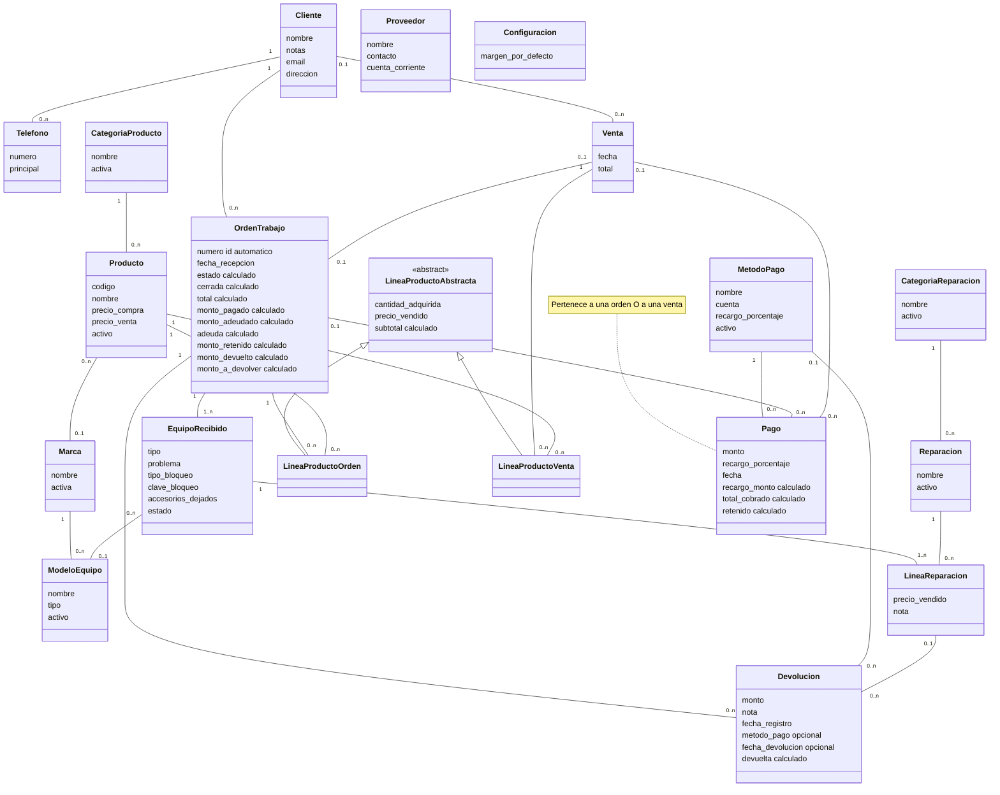

# GMSol — Diagrama de clases (v6, módulos 1 a 3 hasta las devoluciones)

> **Uso:** documento autosuficiente para cargar como contexto. **Reemplaza** a la v5 y a [diagrama-clases-modulo1y2-orden.md](diagrama-clases-modulo1y2-orden.md) (v4). Complementa a [BPMN.md](../BPMN%20Y%20MODELO/BPMN.md), [stack_tecnologico.md](../DISEÑO/stack_tecnologico.md) y [0_Plan.md](0_Plan.md).
> **Estado:** módulos 1 (catálogo) y 2 (orden de trabajo) cerrados. Módulo 3 (pagos y ventas): `MetodoPago`, `Pago`, `Venta`, líneas de venta directa, dinero retenido y **devoluciones** (Fase 5) hechos y con tests. Pruebas manuales en el admin hechas; faltan los fiados y los pagos pendientes de acreditar (Fases 3 y 4, después de la beta). Faltan los módulos 4 y 5 (caja y movimientos, compras).
> **Código:** las clases del diagrama están en `catalogo/models.py`, salvo `Producto.codigo`, `Proveedor`, `Configuracion`.
> **Vocabulario:** **Venta** = registro interno que cierra una transacción e impacta stock y caja (antes "factura"). **Comprobante ARCA** = documento legal, es otra cosa (etapa 8).
> **Leyenda:** ✅ decisión del desarrollador · 💡 propuesta (falta confirmar) · ❓ pendiente

---

## 1. Diagrama

**Cómo se lee una cardinalidad:** el número junto a una clase dice cuántos objetos de *esa* clase se relacionan con **uno** del otro lado. Ejemplo: `Venta "0..1" -- "0..n" Pago` = una venta tiene de 0 a n pagos; un pago tiene 0 o 1 venta.

`Proveedor` y `Configuracion` no tienen relaciones por ahora. El número de la orden es su `id` y `fecha_recepcion` se completa sola (no admite fechas pasadas).

---

## 2. Clases (solo lo que no se ve en el diagrama)

| Clase | Módulo | Nota |
|---|---|---|
| Cliente | 1 | ✅ Obligatorios: nombre y teléfono (regla suave, ver §4). Opcionales: email y dirección. Sin DNI. ❓ `codigo`: decidir si se mantiene |
| Telefono | 1 | ✅ Clase separada, con `principal`. ❓ Falta etiqueta y regla de un solo principal |
| Proveedor | 1 | ❓ "Otros datos" sin definir. Se usa en el módulo 5 |
| Configuracion | 1 | ✅ Un solo margen por defecto para todos los productos |
| CategoriaProducto | 1 | ✅ Editable por el dueño. Incluye una categoría genérica |
| Producto | 1 | ✅ Los accesorios son productos. Las variantes van como productos distintos. `codigo` visible y editable; el `id` es interno |
| Marca | 1 | ✅ Compartida entre productos y modelos de equipo |
| ModeloEquipo | 1 | ✅ Modelo del equipo que se repara (celular o notebook) |
| CategoriaReparacion | 1 | ✅ Editable. Agrupa variantes de una reparación para estadísticas. Incluye una genérica |
| Reparacion | 1 | ✅ Catálogo de reparaciones. **Sin precio**. Incluye "Revisión / diagnóstico" |
| OrdenTrabajo | 2 | ✅ Un trabajo por visita. Siempre tiene al menos un equipo. No guarda estado: lo calcula (§4) |
| EquipoRecibido | 2 | ✅ Guarda el `estado` (`pendiente`, `arreglado`, `no_arreglable`, `sin_falla`). La PC va sin modelo. **Siempre empieza `pendiente`** (se ve como "En revisión / reparación"): el resultado se carga después de revisarlo. Tipo de bloqueo por defecto: `ninguno` |
| LineaReparacion | 2 | ✅ Reparación del catálogo acordada para un equipo, con **precio de esa orden** |
| LineaProductoAbstracta | 3 | ✅ **Clase abstracta, sin tabla.** Comparte `cantidad_adquirida`, `precio_vendido` (copiado del producto y editable), `producto` y `subtotal` |
| LineaProductoOrden | 3 | ✅ Hija: producto agregado a una orden de trabajo (FK `orden_trabajo`) |
| LineaProductoVenta | 3 | ✅ Hija: producto de una venta directa (FK `venta`) |
| MetodoPago | 3 | ✅ Editable por el dueño. `cuenta` es enumeración: `efectivo` o `digital`. `recargo_porcentaje` es el valor **sugerido** |
| Pago | 3 | ✅ Dinero contra el total de una orden o de una venta (no contra un producto). `monto` = lo que ingresa al negocio. `recargo_porcentaje` es una **copia editable** del método, queda como foto |
| Venta | 3 | ✅ Registro interno que cierra una orden (`orden_trabajo`, uno a uno) o es venta directa (sin orden). `total` es una **foto**. `cliente` opcional |
| Devolucion | 3 | ✅ Dinero que hay que devolver al cliente. Dos momentos: se **registra** (fecha vacía, el dinero sigue reservado) y después se **marca devuelta** al elegir el método (la fecha se completa sola). Se puede cargar por monto o eligiendo una reparación completa (el monto se completa solo) |

---

## 3. Relaciones

| Relación | Cardinalidad | `on_delete` en el código | Regla |
|---|---|---|---|
| Cliente — Telefono | 1 — 0..n | `CASCADE` | ✅ Regla suave (§4) |
| CategoriaProducto — Producto | 1 — 0..n | `PROTECT` | Un producto tiene una sola categoría |
| Producto — Marca | 0..n — 0..1 | `PROTECT` | ✅ Marca opcional |
| Marca — ModeloEquipo | 1 — 0..n | `PROTECT` | |
| CategoriaReparacion — Reparacion | 1 — 0..n | `PROTECT` | |
| Cliente — OrdenTrabajo | 1 — 0..n | `PROTECT` | Toda orden tiene cliente |
| OrdenTrabajo — EquipoRecibido | 1 — 1..n | `CASCADE` | ✅ Al menos un equipo (se valida en la pantalla) |
| EquipoRecibido — LineaReparacion | 1 — 1..n | `CASCADE` | Todo equipo lleva al menos una línea |
| EquipoRecibido — ModeloEquipo | 0..n — 0..1 | `PROTECT` | La PC no lleva modelo |
| Reparacion — LineaReparacion | 1 — 0..n | `PROTECT` | |
| OrdenTrabajo — LineaProductoOrden | 1 — 0..n | `CASCADE` | La línea es parte de la orden |
| Venta — LineaProductoVenta | 1 — 0..n | `CASCADE` | La línea es parte de la venta directa |
| Producto — LineaProductoOrden / LineaProductoVenta | 1 — 0..n | `PROTECT` | `related_name="%(class)ss"` en la base abstracta, para que las dos hijas no choquen |
| MetodoPago — Pago | 1 — 0..n | `PROTECT` | |
| OrdenTrabajo — Pago | 0..1 — 0..n | `PROTECT` | La seña entra antes de que exista la Venta, por eso cuelga de la orden |
| Venta — Pago | 0..1 — 0..n | `PROTECT` | Pagos de una venta directa |
| Venta — OrdenTrabajo | 0..1 — 0..1 | `PROTECT` (uno a uno, `related_name="venta"`) | Una orden tiene a lo sumo una venta; una venta directa no tiene orden |
| Cliente — Venta | 0..1 — 0..n | `PROTECT` | ✅ Cliente opcional en venta directa. En una reparación se copia el de la orden al cerrar |
| OrdenTrabajo — Devolucion | 1 — 0..n | `PROTECT` | Solo en órdenes abiertas. Entre todas las devoluciones no pueden superar lo pagado |
| MetodoPago — Devolucion | 0..1 — 0..n | `PROTECT` | Se elige al devolver; es informativo (la seña retenida nunca estuvo en la caja) |
| LineaReparacion — Devolucion | 0..1 — 0..n | `PROTECT` | Solo reparaciones de la misma orden, una devolución por reparación (✅ 17/11/2026: también de equipos que se arreglan, ver §4.5) |

Todas las relaciones se dibujan en ambos sentidos y no se dibujan las derivables. Criterio de `on_delete`: `CASCADE` cuando la clase es **parte de** otra; `PROTECT` cuando apunta a un dato que no debe desaparecer si está en uso.

---

## 4. Reglas de diseño

### 4.1 Heredadas (módulos 1 y 2)

| Regla | Detalle |
|---|---|
| **Nada se borra, se desactiva** | `activa` / `activo` en las clases editables |
| **El margen no se guarda** | Se calcula; `Configuracion.margen_por_defecto` solo sugiere el precio de venta |
| **Enumeraciones** | Estado del equipo, tipo de bloqueo y cuenta del método de pago. Valor interno simple (`contrasena`, `ninguno`) y etiqueta legible. ✅ 18/11/2026: el **tipo de equipo** dejó de ser una enumeración: es la tabla `TipoEquipo` (nombre, clave, activo), editable en el Catálogo. Equipos y modelos apuntan a `TipoEquipo.clave` (la columna sigue guardando `celular`, `notebook`, `pc`) |
| **Orden en tres niveles** | OrdenTrabajo → EquipoRecibido → LineaReparacion |
| **Precio por orden** | Las líneas guardan su propio precio: órdenes y ventas viejas no cambian |
| **Problema, accesorios y clave** | Texto libre. Los accesorios que deja el cliente son una nota, no productos. La clave se guarda tal cual (login + backups cifrados) |
| **Categorías genéricas** | Toda reparación y todo producto tiene categoría obligatoria; existe "Otras" |
| **Equipo sano o sin diagnóstico** | Todo equipo lleva al menos una línea ("Revisión / diagnóstico"); si no tiene falla queda `sin_falla` |
| **Teléfono: regla suave** | Se pide siempre, se puede guardar sin él confirmándolo; el sistema lista los clientes sin teléfono |
| **Un solo teléfono principal** | ✅ Se valida en la tabla de teléfonos del admin (`TelefonoFormSet`) |
| **Nombres únicos** | ✅ Único: `MetodoPago`, `CategoriaProducto`, `CategoriaReparacion`, `Marca`, `Producto`. Único por pareja: `Reparacion` (categoría + nombre), `ModeloEquipo` (marca + nombre). No único: `Cliente`, `Telefono` |
| **Solo activos en altas** | ✅ Los desplegables de categoría y marca (`limit_choices_to`) muestran solo las activas. ❓ Faltan método de pago, producto y reparación |
| **Bloqueo del equipo** | ✅ Si el tipo es `ninguno`, la clave debe quedar vacía |
| **Precio de la línea de producto** | ✅ Si se deja vacío, se copia de `Producto.precio_venta` al guardar |
| **Producto repetido** | ✅ No puede repetirse el mismo producto en las líneas de una orden o de una venta (se valida en el admin) |
| **Nombres** | Español. PascalCase para clases, snake_case para atributos |

### 4.2 Estados de la orden (calculados, nunca guardados)

| Estado | Cuándo |
|---|---|
| `pendiente` | Algún equipo está pendiente (o no hay equipos) |
| `no_arreglable` | Todos los equipos son `no_arreglable` y **queda dinero retenido** (falta devolverlo). No genera Venta |
| `finalizada` | Todos los equipos son `no_arreglable` y **no queda dinero retenido**. ✅ 18/11/2026: falta **devolverle el equipo al cliente**; al hacerlo se cierra con una Venta de $0 (entrega sin cargo) y pasa a `cerrada`. Si se corrige un equipo, la orden vuelve a otro estado |
| `lista` | Ningún equipo pendiente y no todos son no arreglables. ✅ 18/11/2026: también si **todos** son no arreglables pero la orden **tiene productos** (el cliente se los lleva): se cobran y se cierra con una Venta de esos productos (antes la orden quedaba trabada) |
| `cerrada` | Tiene una Venta. Retiro y venta son el mismo acto. Es el único estado que bloquea la orden |

### 4.3 Dinero (módulo 3)

| Regla | Detalle |
|---|---|
| **Dos datos por pago** | *Por dónde entró* (`MetodoPago.cuenta`: efectivo o digital) y *estado del dinero* (🔒 retenido · ⏳ pendiente de acreditar · ✅ disponible). Efectivo y digital son **dos cuentas de la caja**, no un "retiro" como en el Excel del dueño |
| **Retenido** | Todo pago de una orden está retenido hasta que la orden se cierra. `Pago.retenido` y `OrdenTrabajo.monto_retenido` **se calculan**. Los pagos de venta directa nunca están retenidos |
| **Recargo** | `Pago.recargo_porcentaje` se copia del método al crear (si viene vacío) y se puede cambiar. `recargo_monto = monto × % / 100`, **redondeado a centavos**; `total_cobrado = monto + recargo` (lo que paga el cliente) |
| **Montos de la orden** | `total` no cuenta las reparaciones de equipos `no_arreglable`. `monto_pagado` = suma de `Pago.monto` (sin recargo) **menos lo ya devuelto**. `monto_adeudado = total − monto_pagado`. En el admin se muestra como **Saldo** en palabras (`Debe $X`, `A favor del cliente: $X (se debe devolver)`, `Saldado`) |
| **Pago y productos** | Un pago no se relaciona con productos: es dinero contra el total. Un cargador pagado mitad efectivo y mitad tarjeta son dos pagos sobre la misma venta |
| **Un pago, un dueño** | Un `Pago` pertenece a una orden **o** a una venta. 💡 `Pago.clean()` rechaza que tenga las dos; una restricción en la base rechaza las dos y ninguna (en el admin, al crear una orden nueva la FK a la orden todavía no existe cuando corre `clean()`, por eso "ninguna" no se valida ahí) |
| **Pago ≤ adeudado** | ✅ `Pago.clean()` lo valida solo para pagos **nuevos o con el monto cambiado**: un pago ya guardado no se vuelve a controlar (el total puede bajar después, por ejemplo con un equipo no arreglable). Si la orden todavía no tiene precio (total 0) se permite la seña. Los pagos creados por código no pasan por `clean()`; el cierre exige saldo 0 |
| **ARCA** | `facturar_arca` en cada pago, etapa 8 |

### 4.4 Venta (módulo 3)

| Regla | Detalle |
|---|---|
| **Qué es** | Cierra una orden de reparación o es una venta directa. No genera ticket para el cliente |
| **Venta de reparación** | Se vincula a la orden (uno a uno). Líneas y pagos quedan en la orden. `total` se copia de `orden.total` al crear. `cliente` se copia de la orden |
| **Venta directa** | Sin orden. Sus productos son `LineaProductoVenta` y sus pagos son `Pago` con `venta`. `total` = suma de sus líneas |
| **Condiciones de cierre** | Orden: estado `lista` y sin deuda. Venta directa: pagada completa (la Fase 3 lo relaja para fiados) |
| **Orden cerrada no se edita** | Ni líneas ni pagos |
| **Clases hermanas, no campo opcional** | Las líneas de producto se dividen en dos clases con base abstracta, así ninguna línea tiene dos dueños posibles |
| **Producto al retirar** | Si no se registra en la orden, es una venta directa aparte (BPMN, Call Activity) |
| **Stock y caja** | La Venta **no** los toca en esta etapa. Se descuentan al registrar la Venta, en una sola transacción (etapa 4). Stock disponible = físico − reservado en órdenes abiertas (calculado) |

### 4.5 Devoluciones (módulo 3)

| Regla | Detalle |
|---|---|
| **Dos pasos separados** | 1) *Registrar que hay que devolver*: en la orden, con monto o eligiendo una reparación. El dinero **sigue reservado** (`monto_a_devolver`). 2) *Marcar que ya se devolvió*: en el menú Devoluciones se elige el método y la fecha se completa sola. Recién ahí baja `monto_pagado` y `monto_retenido` |
| **Devolver una reparación completa** | Se elige la reparación y el monto se completa con su precio. Solo reparaciones de la misma orden, una vez cada una |
| **Devolver una reparación que se cancela** | ✅ 17/11/2026 (pedido del dueño): cualquier reparación de una orden abierta se puede devolver, aunque el equipo se arregle (el cliente ya no la quiere). **No se borra:** queda en la orden marcada como devuelta y **deja de sumar al total** (`OrdenTrabajo.lineas_devueltas`). El monto se calcula solo (`servicios.monto_para_devolver`): lo que el cliente pagó de más una vez que la reparación sale del total, nunca más que su precio; si es 0 no hay nada que devolver y se ofrece quitarla. Se hace desde el menú Devoluciones (con método = hecha en el acto; sin método = queda pendiente) o desde la orden |
| **Límites** | Entre todas las devoluciones (pendientes y hechas) no superan lo pagado. Solo en órdenes abiertas (sin Venta) |
| **Orden mixta** | Si un equipo no se arregla, su reparación sale del total y el pago queda de más: se devuelve la diferencia y recién con saldo 0 se cierra la orden con Venta |
| **Equipo nuevo** | Siempre empieza `pendiente`. Un equipo nuevo no puede crearse con un resultado |
| **Pago con tarjeta** | ✅ Confirmado por el dueño: la devolución se hace desde la plataforma de la tarjeta (dentro de su plazo), que devuelve todo lo que pagó el cliente, recargo incluido. En el sistema se registra el `monto` que entró al negocio y el método es informativo |
| **Revisión / diagnóstico** | ✅ Por lo general el dueño **no** cobra la revisión de un equipo que no se arregla. ❓ A veces la cobra si el desarme es muy complicado (ver pendientes) |

---

## 5. Pendientes

### 5.1 Hecho ✅

| Tema | Resultado |
|---|---|
| Fase 1 | `MetodoPago` y `Pago`, con recargo copiado del método |
| Fase 2 | `Venta`, `cerrar_orden`, `vender_directo`, líneas de producto con base abstracta, un pago un dueño, dinero retenido |
| Fase 5 | `Devolucion` en dos pasos, devolver reparación completa, estado `finalizada`, `total` sin equipos no arreglables, saldo en palabras |
| Correcciones del admin | Nombres únicos, un solo teléfono principal, solo activos en categorías y marcas, `ninguno` sin clave, precio copiado del producto, producto no repetido, pago ≤ adeudado, sin precios negativos |
| Reporte de pruebas manuales | Equipo siempre empieza en revisión, bloqueo `ninguno` por defecto, pago existente ya no se revalida, columnas con producto o reparación primero, número de orden en los títulos, vuelta al menú de órdenes |
| Redondeo | `recargo_monto` a centavos |

### 5.2 Pendientes por decidir ❓

| # | Tema | Detalle |
|---|---|---|
| 1 | **Cobro excepcional de diagnóstico** | El dueño a veces cobra la revisión si el equipo no se arregla y el desarme fue muy complicado. Hoy un equipo no arreglable no cobra nada. 💡 Marca `Reparacion.se_cobra_si_no_se_arregla` (por ejemplo para "Desarme complejo"), `total` la cuenta aunque el equipo no se arregle, y `cerrar_orden` permite la Venta si el total es mayor que 0 y el saldo es 0. Es raro: se puede hacer después de la beta |
| 2 | **Orden cerrada** | Se bloquea en el admin, no en el modelo: desde código o shell se podría editar (etapa 6) |
| 3 | **Pagos con varias filas** | Dos pagos nuevos en la misma pantalla que juntos superan el saldo pasan la validación; el cierre exige saldo 0 (etapa 6) |
| 4 | **Activos en transacciones** | Método de pago, producto y reparación inactivos siguen apareciendo al cargar una línea o un pago (pantalla propia) |
| 5 | **Cancelación por el cliente** | Se arrepiente antes de arreglar: nuevo estado de equipo "cancelado", parecido a no arreglable |
| 6 | **Estados del equipo** | Se puede pasar de `arreglado` a `pendiente` mientras la orden esté abierta. Falta historial de estados (etapa 6) |
| 7 | **Venta de $0** | ✅ 18/11/2026: queda. Un equipo sin falla, una revisión gratis o un equipo sin arreglo devuelto cierran con una Venta de $0 (en el registro dice «sin cargo») |

### 5.3 Para la interfaz propia (etapa 7)

| # | Tema |
|---|---|
| 8 | **Diseño:** minimalista, nada genérico ni que parezca hecho con IA. Es prioridad del desarrollador |
| 9 | **Orden de carga:** siempre primero el producto o la reparación y después el precio |
| 10 | **Número de la orden** siempre visible al editar cualquier cosa de esa orden |
| 11 | **Cálculo en vivo** del total, subtotal y saldo sin tener que guardar (JavaScript) |
| 12 | **PIN y patrón visuales:** grilla de 9 puntos (`1-5-9-6`) y validación de formato |
| 13 | **Orden en una sola pantalla:** equipo, reparaciones, productos, pagos; alta de reparación "al vuelo" y línea "Revisión / diagnóstico" automática y editable |
| 14 | **Devoluciones:** que se note la diferencia entre registrar que hay que devolver y devolver |
| 15 | **Pago ≤ adeudado** y demás validaciones, con mensajes claros |

### 5.4 Fases y etapas futuras

| # | Tema |
|---|---|
| 16 | Fase 3: fiados (`monto_pagado` y `monto_adeudado` en `Venta`, cliente obligatorio si queda saldo). Después de la beta |
| 17 | Fase 4: pagos pendientes de acreditar (GoCuotas, tarjeta diferida). Después de la beta |
| 18 | ❓ Costo del repuesto en cada línea de reparación (ganancia) |
| 19 | ❓ `Producto.codigo`, `Cliente.codigo`, datos de `Proveedor`, margen por categoría, teléfono (etiqueta) |
| 20 | ❓ Blindar en la base las reglas de cantidad y precio |
| 21 | Módulos 4 y 5: caja y movimientos, compras y proveedores |
| 22 | **Estadísticas solo de productos** (pedido del dueño, 18/11/2026): ver aparte lo vendido en productos (cantidades, montos, margen, por categoría y por período), sin mezclar con las reparaciones. Los datos ya lo permiten: los productos están en `LineaProductoVenta` (ventas rápidas) y `LineaProductoOrden` (productos llevados en una orden que se cerró con Venta), cada línea con su precio de ese momento; el costo sale de `Producto.precio_compra` (hoy no se guarda el costo en la línea: ver #18). Hay que unir las dos tablas y contar solo las órdenes cerradas |

---

> **Me gusta que me preguntes si quiero avanzar al siguiente paso o no, antes de avanzar.**
