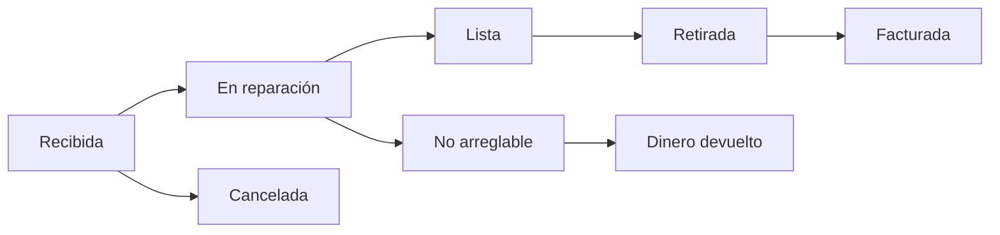
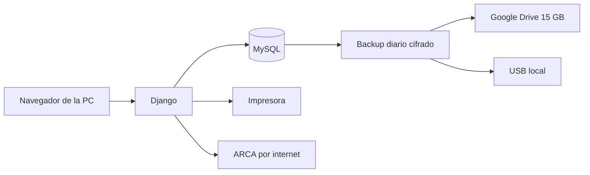

# GMSol — Stack y arquitectura (v3)

> **Uso:** documento autosuficiente para cargar como contexto. Complementa a [BPMN_nuevo.md](BPMN_nuevo.md).
> **Estado:** etapa de planificación. Proyecto **real, para producción**, sin fecha límite.
> **Leyenda:** ✅ definido · 🟡 propuesto (falta confirmar)

---

## 1. Resumen de decisiones

| Tema | Decisión | Estado |
|---|---|---|
| Lenguaje y framework | **Python + Django** (plan B: Java, ver §3.2) | ✅ |
| Base de datos | **MySQL** (InnoDB) | ✅ |
| Tipo de app | Web, usada desde la PC del local | 🟡 |
| Arquitectura | Monolito en capas, reglas del negocio separadas | 🟡 |
| Control de estado | Máquina de estados solo para la Orden de trabajo | 🟡 |
| Pantallas | Plantillas de Django + HTMX + Bootstrap/Tailwind | 🟡 |
| Servidor / web | **Local, en la PC del negocio** (Django + MySQL gratuitos). Vercel descartado (ver §9) | ✅ |
| Backups | **Google Drive gratuito (15 GB)** + copia local (ver §9.5) | ✅ |
| Costo | **$0**: todo el stack es gratuito | ✅ |
| Usuarios | Uno solo (por ahora), con login | ✅ |

---

## 2. Contexto del negocio (respuestas confirmadas)

| Dato | Valor |
|---|---|
| Equipo del dueño | Usa principalmente **PC** y tiene **impresora** |
| Internet en el local | Estable |
| Empleados | Ninguno por ahora |
| Régimen fiscal | **Monotributista** (por lo general se emite **Factura C**) |
| Datos existentes | Varias planillas Excel (precios, stock, compras, registros). Migrarlas es **deseable, no obligatorio** |
| Firma del cliente | **En papel** |
| Recargos por método de pago | Precargados y fijos; **al facturar siempre se pregunta** si se quiere cambiarlos |
| Estética de la interfaz | No es prioridad |
| Presupuesto | **$0**: todo debe ser gratuito, sin pagar hosting |
| Respaldo de datos | Quiere usar un **Google Drive gratuito de 15 GB** |

---

## 3. Lenguaje y framework

### 3.1 Elección: Python + Django

Por qué:
- El sistema tiene muchas **altas** (productos, clientes, proveedores, dispositivos). El **panel de admin de Django** resuelve gran parte casi sin programar.
- Menos piezas nuevas que aprender que con TypeScript.
- Leer y migrar los Excel es sencillo.
- Generar el PDF de la orden para imprimir es sencillo.
- Hay bastante material en español sobre facturación con ARCA/AFIP en Python.
- Un solo usuario, en PC, con internet estable: no hace falta una interfaz muy dinámica.

Alternativa descartada: TypeScript (Node + NestJS + React). Hay que armar casi todo a mano y llevar dos proyectos.

### 3.2 🔁 Plan B: pasar a Java (Spring Boot) si Django no convence

El desarrollador **domina Java**. Se acordó probar Django y, si no se siente cómodo, **migrar a Java** más adelante.

Para que ese cambio sea barato, desde el inicio se sigue esto:

| Regla | Para qué |
|---|---|
| Reglas del negocio en **clases propias**, sin depender de Django | Se traducen a Java casi uno a uno |
| **MySQL** como fuente de verdad, con un esquema claro | La BD no cambia al migrar |
| Lógica de estados y flujos **documentada en `.md`** | Sirve de especificación en cualquier lenguaje |
| Usar lo mínimo de "magia" específica de Django en el dominio | Menos cosas que reescribir |

**Qué se perdería al migrar:** el panel de admin gratuito. En Java habría que armar las pantallas de altas a mano.

**Cuándo decidir:** conviene evaluar después de implementar las primeras entidades (productos, clientes, órdenes) y ver cómo se siente.

---

## 4. Arquitectura

Monolito en 3 capas:

```
Pantallas  →  Reglas del negocio (dominio)  →  Base de datos
```

Las reglas (estados, recargos, facturar, mover caja y stock) viven en la capa del medio. Patrones previstos:

| Patrón | Dónde se usa |
|---|---|
| **State** | Estados de la Orden de trabajo |
| **Strategy** | Métodos de pago y cálculo de recargos |
| **Repository** | Acceso a datos, aislando el dominio del ORM |

---

## 5. Control de flujo y estado

- **No se usa un motor BPMN.** El BPMN es guía de diseño y se traduce a una máquina de estados.
- El sistema **no modela la charla con el cliente** (presupuestar, negociar, aceptar). Solo **registra resultados**.
- La **venta directa no tiene estados**: es una única transacción (factura + stock + caja).
- **"Solicitar producto ya"** al retirar = crear una venta directa aparte.
- Cada estado define qué acciones permite (ej.: no se factura una orden "En reparación").



> Los estados exactos y sus transiciones se cierran en el diagrama de clases.

---

## 6. Base de datos y persistencia

**MySQL con InnoDB** (transacciones seguras). Elegido por comodidad del desarrollador.

| Qué | Cómo se guarda |
|---|---|
| Estado actual de la orden | Columna `estado` en la tabla `orden` |
| Historial | Tabla `orden_historial` (orden, estado, fecha). **Solo se agrega, nunca se edita** |
| Dinero | Tabla `movimiento_caja` (efectivo o transferencia, entrada o salida). El saldo se calcula |
| Stock | Tabla `movimiento_stock`, misma lógica |
| Facturas | No se modifican. Un error se corrige con otro registro |

**Reglas:**
- Al facturar, **factura + stock + caja se guardan en una sola transacción**: o todo o nada.
- El dinero se guarda como `DECIMAL`, **nunca** `FLOAT`.
- **Migración de Excel:** script de importación para precios, stock y compras (opcional, se hace después de tener el modelo de datos).

---

## 7. Seguridad (mínima, pero necesaria)

Aunque corra en la PC del local, la orden guarda **PIN y patrones de bloqueo** de los dispositivos de clientes. Si algún día se expone a internet, la seguridad pasa a ser más crítica.

| Medida | Estado |
|---|---|
| Login con contraseña guardada con hash | ✅ |
| HTTPS | ✅ solo si se accede desde internet (en la PC local no hace falta) |
| **Backups automáticos** (lo más importante), **cifrados** antes de subirlos a Drive | ✅ |
| Credenciales de ARCA fuera del código | ✅ |

---

## 8. Interfaz de usuario

- **Plantillas de Django + HTMX** (actualiza partes de la pantalla sin JavaScript complejo).
- **Bootstrap o Tailwind** para un aspecto prolijo sin diseñar desde cero.
- Posible tema para el panel de admin si se quiere algo más moderno.

**La pantalla se arma según el estado de la orden:**
- Indicador de progreso arriba (Recibida → … → Facturada) con el paso actual resaltado.
- Solo aparecen los **botones válidos** para ese estado (ej.: "Marcar lista", "Registrar retiro", "Facturar").
- La lista de órdenes se filtra por estado (ej.: "Listas para avisar").

**Impresión de la orden:** PDF con dos partes.
- Parte del empleado.
- Parte recortable para el cliente: firma del empleado, fecha, nombre del cliente y aviso de que **pasados 30 días no hay reclamos**.
- La firma del cliente es en papel.

---

## 9. Servidor / web (todo gratis)

**Restricción:** presupuesto $0. Todo el stack tiene que ser gratuito y permitido para uso comercial (es un negocio real).

### 9.1 ¿Vercel lo resuelve? No

| Motivo | Detalle |
|---|---|
| **Uso comercial** | El plan gratis (Hobby) es **solo para uso personal no comercial**. Un negocio real requiere el plan Pro, que ronda los **US$20 por mes** |
| Encaje técnico | Está pensado sobre todo para sitios y funciones en la nube (Next.js/Node). Django + MySQL no es su caso típico y habría que sumar una base de datos externa aparte |

Usarlo igual violaría sus términos y podrían bloquear el proyecto.

### 9.2 Opciones gratis

| Opción | Costo | Pro | Contra |
|---|---|---|---|
| **PC del negocio (local)** ✅ elegida | $0 | Sin límites ni cuentas de terceros. Los datos quedan en el local. No expuesta a internet. Sin restricciones de uso comercial | Solo se usa desde el local. Si falla la PC, depende del backup |
| Oracle Cloud "Always Free" (nube) | $0 | Acceso desde cualquier lugar | Pide tarjeta. Oracle puede recuperar instancias inactivas, redujo lo gratis en junio 2026 y no garantiza el servicio. No recomendable para datos críticos |
| Vercel Hobby | $0 | — | **No permite uso comercial** |

### 9.3 Stack 100% gratuito

| Pieza | Herramienta | Costo |
|---|---|---|
| Framework | Django (código abierto) | $0 |
| Base de datos | MySQL Community | $0 |
| Pantallas | HTMX + Bootstrap/Tailwind | $0 |
| PDF de la orden | Librería de PDF de Python (ej.: WeasyPrint o ReportLab) | $0 |
| Servidor de la app | Servidor de producción gratuito según el sistema operativo (ej.: Waitress en Windows) | $0 |
| Backup | Copia automática a Google Drive (15 GB gratis) + copia local en USB | $0 |

### 9.4 Cómo funciona



- Django y MySQL corren **en la misma PC** del negocio y se usan desde el navegador (`localhost`).
- Internet solo se necesita para facturar con ARCA y para subir el backup a Drive.
- **El backup es obligatorio:** si la PC falla, es lo único que protege los datos (ver §9.5).

### 9.5 Backups en Google Drive (15 GB gratis)

**¿Alcanzan los 15 GB?** Sí, con margen. La base de un negocio de un solo usuario es chica (del orden de decenas de MB) y comprimida pesa mucho menos. Aun con un backup por día durante años y una política de retención, el uso queda muy por debajo del límite.

**Política de retención propuesta:**

| Qué se guarda | Cuánto tiempo |
|---|---|
| Backups diarios | Últimos 30 días |
| Backups mensuales | Últimos 12 meses |
| Lo demás | Se borra automáticamente |

**Cómo funciona:**
1. Una tarea programada del sistema hace el volcado de MySQL (`mysqldump`) cada día.
2. Se comprime y se **cifra con contraseña** (la base tiene PIN y patrones de bloqueo de clientes).
3. Se copia a la carpeta sincronizada de Google Drive y a un USB.
4. Se borran los backups viejos según la retención.

**Ojo con estos puntos:**

| Punto | Detalle |
|---|---|
| Espacio compartido | Los 15 GB se comparten entre Drive, Gmail y Fotos de esa cuenta. Conviene usar una **cuenta de Google dedicada** al negocio |
| Cifrado | Sin cifrar, quien acceda a la cuenta vería datos de clientes |
| Probar la restauración | Un backup que nunca se probó no es confiable. Probarlo al menos una vez al armar el sistema |
| Los archivos adjuntos | Si más adelante se guardan fotos o documentos, se suman al espacio |

### 9.6 Más adelante (opcional)

Si se necesita acceso desde fuera del local, se pueden evaluar opciones gratuitas de acceso remoto. Se decide cuando haga falta.

---

## 10. Pendientes

| # | Tema |
|---|---|
| 1 | Confirmar el sistema operativo de la PC del negocio |
| 1b | Confirmar que la integración con ARCA no tenga costo (certificado digital y servicios) |
| 2 | Cómo integrar la facturación con ARCA (directo o mediante un servicio intermedio) |
| 3 | Diagrama de clases (paso siguiente) |
| 4 | Modelo de datos y esquema MySQL |
| 5 | Decidir si se migra a Java (ver §3.2), tras las primeras entidades |
| 6 | Pendientes del BPMN v2 (accesorios múltiples, pedido de repuestos, seña 0%, etc.) |
| 7 | Elegir cómo subir el backup a Drive (carpeta sincronizada con Google Drive para escritorio u otra herramienta gratuita) y crear la cuenta dedicada |
